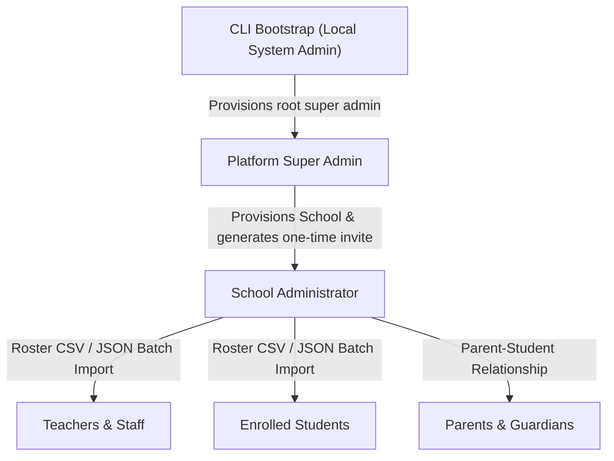

# EDOPS User Provisioning & Account Management Guide

This document describes the institutional account provisioning lifecycle, security boundaries, and onboarding workflows for the **EDOPS** School SaaS Platform.

---

## 1. Onboarding Hierarchy & Account Lifecycles

EDOPS strictly enforces institutional multi-tenancy. Accounts are provisioned through a top-down cryptographic hierarchy:



---

## 2. Bootstrapping the Platform Super Admin

The root Platform Administrator is bootstrapped exclusively through the backend CLI. The system will **never** create a default administrator with pre-seeded passwords, and it prevents multiple platform admins from being bootstrapped.

### CLI Command:

From the `backend/` directory:

```bash
cd backend
npm run bootstrap:admin -- admin@your-domain.com
```

### Security Constraints:
- Prompts for a hidden password via stdin (between 12 and 128 characters).
- Never accepted as a command-line argument to protect shell history.
- Hashed using Node.js native `scrypt` with a unique 16-byte random salt.
- An advisory transaction lock ensures only one platform super admin is bootstrapped.

---

## 3. Provisioning School Administrators

Once logged into the **Platform Control Center** (`/platform/schools`), the Platform Administrator provisions new school tenants:

1. **Submit School Details**: Provide organization name, slug, timezone, locale, and school administrator email.
2. **One-Time Cryptographic Invitation**: The system generates a single-use, 48-hour invitation token.
3. **Invitation Acceptance**: The school administrator accesses the invite link (`/auth/invitations/accept`) and configures their own secure password.

---

## 4. Provisioning Teachers, Students & Parents

School Administrators manage institutional rosters through the **School Admin Command Center** (`/school-admin/people`):

- **Bulk CSV / JSON Import**: Upload up to 100 members per batch with transactional schema validation and AES-256 idempotency protection.
- **Invitation Tokens**: Each invited member receives a unique token hash.
- **Self-Service Password Creation**: Users set their own passwords upon accepting their invitation, ensuring credentials are never exposed to administrators.
- **Parent-Student Linking**: Guardians are linked to student roll numbers through `parent_student_relationships`.
