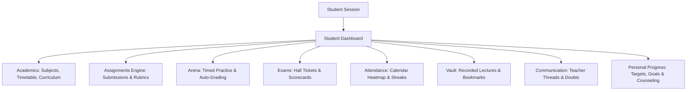
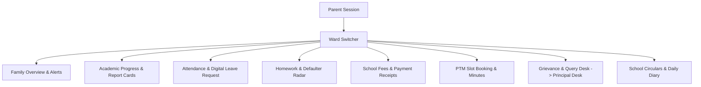

# EDOPS Parent & Student Portal — Comprehensive Implementation Specification
**Document Version:** 1.0.0  
**Target Architecture:** Multi-Tenant School Operations SaaS (B2B LMS)  
**Applicable Standards:** CBSE SARAS & NEP 2020 Holistic Progress Card (HPC), FERPA, India DPDP Act 2023  
**Design System:** Midnight Obsidian (`#090D16`) & Ivory Canvas (`#FFFFFF` / `#F8FAFC`)

---

## 1. Executive Summary & Vision

EDOPS is an institutional B2B School Operating System sold exclusively to schools and educational organizations. Within a school tenant, students and parents form the dual core of the learning lifecycle:
- **The Student Portal (`student`)**: The **active learning command center**. Students attend classes, consume curriculums, submit assignments, take objective arena tests, view timetable and exams, track attendance, watch recorded lectures, set academic goals, and raise real-time doubts with teachers.
- **The Parent Portal (`parent`)**: The **guardian oversight and engagement hub**. Parents observe their children's verified academic progress, track daily attendance and submit digital leave applications, monitor homework completion and teacher remarks, review fee obligations and receipts, communicate privately with educators, schedule PTMs (Parent-Teacher Meetings), and raise formal grievances to school administration.

This document serves as the complete technical and product specification for both portals across data models, business logic, REST APIs, and UI/UX component contracts.

---

## 2. Persona Access Boundaries & Role Matrix

| Capability Area | Student Portal (`student`) | Parent Portal (`parent`) | Authorization Scope |
| :--- | :--- | :--- | :--- |
| **Authentication & Profile** | Individual student credentials | Individual guardian credentials | Tenant-scoped via `memberships` |
| **Ward / Child Switching** | N/A (single student session) | **Multi-child switcher** across enrolled wards | `parent_student_relationships` |
| **Timetable & Daily Schedule** | Active periods, rooms, teacher names, countdown | Child daily schedule & current period indicator | Read-only |
| **Assignments & Homework** | Submit work, attach files, view rubrics & grades | View due dates, submission status, grades & feedback | Student = Write / Parent = Read |
| **Practice Arena** | Attempt questions, live auto-grading, earn streaks | View attempt accuracy, topics practiced & scores | Student = Write / Parent = Read |
| **Attendance & Leaves** | View personal calendar heatmap & percentage | View live check-in, **submit leave applications** | Student = Read / Parent = Read + Write |
| **Exams & Report Cards** | Download digital hall tickets, view scores | Download certified CBSE Term Report Cards | Read-only with PDF download |
| **Holistic Progress Card (HPC)** | Self-assessment & peer-reflection submission | View 360-degree cognitive/socio-emotional card | Student = Self / Parent = Observation |
| **Recorded Lectures & Vault** | Watch videos, track watch %, bookmark items | View lesson topics covered & study resources | Student = Interactive / Parent = Read |
| **Communication & Messages** | 1-on-1 subject doubt queries with teachers | Official teacher messaging & circular receipts | Tenant inbox with role checks |
| **Grievance / Query Desk** | Academic help & counseling requests | **Formal administrative query / grievance filing** | Integrated with `principal_parent_queries` |
| **Fees & Invoicing** | Hidden | **Fee breakdown, online payment, receipts** | Financial isolation (guardians only) |
| **PTM Scheduling** | View booked slots | **Book 1-on-1 PTM time-slots with teachers** | Parent + Teacher mutual slot booking |

---

## 3. Student Portal: Functional Architecture



### 3.1. Daily Learning & Academic Workflow
1. **Live Timetable Radar**:
   - Dynamic highlight for the currently running period, teacher in charge, and room number.
   - Upcoming periods for the day with subject codes and bell times.
2. **Curriculum Tracker**:
   - NCERT/CBSE chapter-by-chapter progression.
   - Milestone checkboxes showing syllabus covered in class vs pending.
3. **Subject & Faculty Roster**:
   - Enrolled subjects with assigned teachers, teacher consultation hours, and instant message links.

### 3.2. Assignment Submission Engine
1. **Assignment States**:
   - `Pending`: Due in future, submission drawer open.
   - `Submitted`: Received before deadline, awaiting evaluation.
   - `Graded`: Evaluated with rubric points and qualitative remarks.
   - `Late / Overdue`: Submitted post-cutoff or past deadline without submission.
2. **Submission Mechanics**:
   - Rich text solution input + secure cloud attachment upload (PDF/Images).
   - Atomic submission locking after teacher final evaluation.
   - Automatic single-student score recalculation.

### 3.3. Arena: Objective Practice Engine
1. **Interactive Formats**:
   - Multiple Choice Single Select (MCQ).
   - Multi-Select Checkboxes.
   - Numerical Integer Entry & Assertion-Reasoning.
2. **Instant Feedback**:
   - Real-time client-side evaluation without async server queue delays.
   - Answer key securely omitted from client payload before attempt completion.
   - Daily question streak counters and topic badges.

### 3.4. Holistic Progress & Counseling
1. **CBSE NEP 2020 Holistic Progress Card (HPC)**:
   - Self-evaluation questionnaires across cognitive, affective, psychomotor, and socio-emotional domains.
2. **Target Goal Setting**:
   - Student-defined academic targets (e.g. "Score 90% in Calculus by Term 1").
   - Deadline tracking with automated progress bars.
3. **Confidential Support & Counseling Desk**:
   - Category tags: `Academic Doubt`, `Peer Relations`, `Career Counseling`, `Special Educational Need`.
   - Priority levels: `Normal`, `Urgent`.

---

## 4. Parent Portal: Functional Architecture



### 4.1. Multi-Child / Ward Switcher
- Parents with multiple children enrolled in the same institution can switch context with a single click.
- Top-level persistent header displays:
  - Child Avatar, Name, Class & Section (e.g. "Class 10-A"), Roll Number.
  - Quick badge for today's attendance status (`Present`, `Absent`, `Excused`).

### 4.2. Attendance & Digital Leave Management
1. **Live Check-in Monitor**:
   - Morning punch-in notification (e.g. "Aarav checked into 10-A at 07:45 AM").
   - Monthly calendar view with color-coded status pills: Present (Emerald), Absent (Rose), Late (Amber), Holiday (Slate).
   - CBSE Affiliation Compliance: Dynamic indicator showing if student falls below the mandatory 75% attendance threshold.
2. **Leave Application Workflow**:
   - Leave Types: `Medical / Sick Leave`, `Family Urgent`, `Academic / Sports Tournament`, `Planned Absence`.
   - Date range picker (From Date - To Date).
   - Reason description and medical certificate file upload.
   - Approval state machine: `Submitted -> Under Review (Class Teacher) -> Approved / Rejected`.

### 4.3. Academic Performance & Report Card Vault
1. **Continuous Assessment Tracker**:
   - Real-time marks for periodic tests, unit assessments, and mid-terms.
   - Subject-wise comparative analysis against class average (without revealing peer identities).
2. **CBSE Holistic Progress Card (HPC)**:
   - Complete 360-degree review: Teacher qualitative remarks, practical project reviews, life skills, physical wellness.
3. **Certified Report Card Downloads**:
   - Digitally signed term report cards generated as tamper-proof PDFs with institutional seal.

### 4.4. Homework & Daily Diary
1. **Daily Classroom Diary**:
   - What was taught today in each period (summarized by subject teachers).
2. **Homework Tracker**:
   - List of all assigned tasks, deadlines, and current completion state.
   - Alerts for incomplete or late homework.

### 4.5. Fee Management & Invoicing
1. **Fee Ledger**:
   - Breakdown of tuition, laboratory, sports, examination, and transport fees.
   - Due dates and upcoming quarterly installments.
2. **Payment History**:
   - Downloadable tax-compliant GST fee receipts.
   - Integration hooks for payment gateways (UPI, Netbanking, Cards).

### 4.6. Parent-Teacher Meeting (PTM) & Communication
1. **1-on-1 Teacher Messaging**:
   - Structured messaging thread with Class Teacher and Subject Teachers.
   - Eliminates informal WhatsApp channels while retaining full audit compliance.
2. **PTM Slot Booking Engine**:
   - Teachers publish 10-minute conference time slots.
   - Parents select preferred time slots; instant confirmation with calendar invite.
3. **Administrative Grievance & Query Desk**:
   - Direct pipeline to the Principal and School Management.
   - Categories: `Academic Quality`, `Transport / Bus Delays`, `Safety & Discipline`, `Fee Query`, `Infrastructure`.
   - Connected directly to backend `principal_parent_queries` table with tracking status: `Open -> Investigating -> Assigned -> Resolved`.

---

## 5. Database Schema & Migration Specification

### 5.1. Core Relationships & Parent Linking Table
```sql
-- Parent-Student Linkage (Multi-ward support)
CREATE TABLE IF NOT EXISTS parent_student_relationships (
  id uuid PRIMARY KEY DEFAULT gen_random_uuid(),
  organization_id uuid NOT NULL REFERENCES organizations(id) ON DELETE CASCADE,
  parent_id uuid NOT NULL,
  student_id uuid NOT NULL,
  relationship_type varchar(30) NOT NULL DEFAULT 'guardian' CHECK (relationship_type IN ('father', 'mother', 'guardian', 'sponsor')),
  is_primary_contact boolean NOT NULL DEFAULT true,
  emergency_phone varchar(20),
  verification_status varchar(24) NOT NULL DEFAULT 'verified' CHECK (verification_status IN ('pending', 'verified', 'revoked')),
  status varchar(20) NOT NULL DEFAULT 'active' CHECK (status IN ('active', 'inactive')),
  created_at timestamptz NOT NULL DEFAULT now(),
  updated_at timestamptz NOT NULL DEFAULT now(),
  UNIQUE(organization_id, parent_id, student_id),
  FOREIGN KEY (organization_id, parent_id) REFERENCES memberships(organization_id, user_id),
  FOREIGN KEY (organization_id, student_id) REFERENCES memberships(organization_id, user_id)
);
CREATE INDEX IF NOT EXISTS idx_parent_student_org ON parent_student_relationships(organization_id, parent_id, status);
```

### 5.2. Parent Leave Application Table
```sql
-- Digital Leave Requests
CREATE TABLE IF NOT EXISTS parent_leave_applications (
  id uuid PRIMARY KEY DEFAULT gen_random_uuid(),
  organization_id uuid NOT NULL REFERENCES organizations(id) ON DELETE CASCADE,
  parent_user_id uuid NOT NULL,
  student_user_id uuid NOT NULL,
  leave_type varchar(32) NOT NULL CHECK (leave_type IN ('sick', 'casual', 'family_event', 'medical_emergency', 'other')),
  start_date date NOT NULL,
  end_date date NOT NULL,
  reason text NOT NULL,
  attachment_url text,
  status varchar(24) NOT NULL DEFAULT 'pending' CHECK (status IN ('pending', 'approved', 'rejected', 'withdrawn')),
  reviewed_by_user_id uuid,
  reviewer_remarks text,
  reviewed_at timestamptz,
  created_at timestamptz NOT NULL DEFAULT now(),
  FOREIGN KEY (organization_id, parent_user_id) REFERENCES memberships(organization_id, user_id),
  FOREIGN KEY (organization_id, student_user_id) REFERENCES memberships(organization_id, user_id)
);
CREATE INDEX IF NOT EXISTS idx_parent_leaves ON parent_leave_applications(organization_id, student_user_id, status);
```

### 5.3. PTM Booking Table
```sql
-- Parent Teacher Meeting Sessions & Bookings
CREATE TABLE IF NOT EXISTS ptm_sessions (
  id uuid PRIMARY KEY DEFAULT gen_random_uuid(),
  organization_id uuid NOT NULL REFERENCES organizations(id) ON DELETE CASCADE,
  title varchar(150) NOT NULL,
  event_date date NOT NULL,
  start_time time NOT NULL,
  end_time time NOT NULL,
  slot_duration_minutes integer NOT NULL DEFAULT 10,
  academic_year_id uuid REFERENCES academic_years(id),
  status varchar(20) NOT NULL DEFAULT 'published' CHECK (status IN ('draft', 'published', 'completed', 'cancelled')),
  created_at timestamptz NOT NULL DEFAULT now()
);

CREATE TABLE IF NOT EXISTS ptm_slot_bookings (
  id uuid PRIMARY KEY DEFAULT gen_random_uuid(),
  organization_id uuid NOT NULL REFERENCES organizations(id) ON DELETE CASCADE,
  session_id uuid NOT NULL REFERENCES ptm_sessions(id) ON DELETE CASCADE,
  teacher_user_id uuid NOT NULL,
  parent_user_id uuid NOT NULL,
  student_user_id uuid NOT NULL,
  slot_start_time time NOT NULL,
  slot_end_time time NOT NULL,
  meeting_mode varchar(20) NOT NULL DEFAULT 'in_person' CHECK (meeting_mode IN ('in_person', 'video_conference')),
  meeting_link text,
  status varchar(20) NOT NULL DEFAULT 'confirmed' CHECK (status IN ('confirmed', 'completed', 'cancelled')),
  teacher_notes text,
  parent_notes text,
  created_at timestamptz NOT NULL DEFAULT now(),
  UNIQUE(organization_id, session_id, teacher_user_id, slot_start_time),
  FOREIGN KEY (organization_id, teacher_user_id) REFERENCES memberships(organization_id, user_id),
  FOREIGN KEY (organization_id, parent_user_id) REFERENCES memberships(organization_id, user_id),
  FOREIGN KEY (organization_id, student_user_id) REFERENCES memberships(organization_id, user_id)
);
```

### 5.4. Student Fee Ledger Table
```sql
-- Student Fee Structure & Transaction Records
CREATE TABLE IF NOT EXISTS student_fee_invoices (
  id uuid PRIMARY KEY DEFAULT gen_random_uuid(),
  organization_id uuid NOT NULL REFERENCES organizations(id) ON DELETE CASCADE,
  student_user_id uuid NOT NULL,
  academic_year_id uuid REFERENCES academic_years(id),
  invoice_number varchar(60) NOT NULL,
  term_title varchar(60) NOT NULL,
  due_date date NOT NULL,
  total_amount numeric(10,2) NOT NULL,
  paid_amount numeric(10,2) NOT NULL DEFAULT 0.00,
  status varchar(20) NOT NULL DEFAULT 'unpaid' CHECK (status IN ('unpaid', 'partially_paid', 'paid', 'overdue', 'waived')),
  items_json jsonb NOT NULL DEFAULT '[]',
  receipt_url text,
  created_at timestamptz NOT NULL DEFAULT now(),
  UNIQUE(organization_id, invoice_number),
  FOREIGN KEY (organization_id, student_user_id) REFERENCES memberships(organization_id, user_id)
);
CREATE INDEX IF NOT EXISTS idx_student_fee_inv ON student_fee_invoices(organization_id, student_user_id, status);
```

---

## 6. REST API Specifications

### 6.1. Student Portal APIs (`/api/v1/organizations/:orgId/student/`)
| Method | Route | Description |
| :--- | :--- | :--- |
| `GET` | `/dashboard` | Metric summary (attendance %, average, pending assignments, next period) |
| `GET` | `/class` | Enrolled section, class teacher details, classmate roster |
| `GET` | `/subjects` | Enrolled subjects, syllabi, teacher information |
| `GET` | `/timetable` | Weekly schedule & today's chronological periods |
| `GET` | `/assignments` | Filtered homework & assignments list |
| `POST` | `/assignments/:id/submit` | Submit homework (text content, file attachments) |
| `GET` | `/arena` | Topic-wise objective practice question sets |
| `POST` | `/arena/:id/attempt` | Submit question attempt with instant auto-grading |
| `GET` | `/assessments` | Unit tests & internal assessment schedules |
| `GET` | `/exams` | Final term datesheet, hall ticket & marksheet |
| `GET` | `/attendance` | Monthly attendance calendar & subject attendance |
| `GET` | `/curriculum` | Chapter-wise syllabus checklist |
| `GET` | `/performance` | Subject score trends & teacher remarks |
| `GET` | `/resources` | Study materials & recorded classroom lectures |
| `POST` | `/resources/lectures/:id/progress` | Update video watch duration & completion % |
| `POST` | `/resources/bookmarks` | Save bookmarks for lectures, notes, and questions |
| `GET` | `/messages` | 1-on-1 teacher & administrative message threads |
| `POST` | `/messages` | Send message or query to subject teacher |
| `GET` | `/progress` | Academic target goals & student support requests |
| `POST` | `/goals` | Create target goal (e.g., target score & deadline) |
| `POST` | `/support-requests` | Request academic doubt or counseling support |

### 6.2. Parent Portal APIs (`/api/v1/organizations/:orgId/parent/`)
| Method | Route | Description |
| :--- | :--- | :--- |
| `GET` | `/wards` | List all verified wards linked to parent account |
| `GET` | `/wards/:studentId/dashboard` | Ward summary (today's attendance, GPA, pending homework, alerts) |
| `GET` | `/wards/:studentId/academics` | Ward subjects, teacher roster, marks & report cards |
| `GET` | `/wards/:studentId/attendance` | Ward calendar heatmap, absence days, aggregate % |
| `POST` | `/wards/:studentId/leaves` | Submit digital leave application with date range & reason |
| `GET` | `/wards/:studentId/leaves` | Track submitted leave requests & teacher approval notes |
| `GET` | `/wards/:studentId/homework` | Ward daily homework tracker, submission state & teacher feedback |
| `GET` | `/wards/:studentId/fees` | Ward fee invoices, breakdown, payment links & receipts |
| `GET` | `/wards/:studentId/diary` | Daily teacher diary entries for the classroom |
| `GET` | `/notices` | School-wide administrative circulars & event bulletins |
| `GET` | `/messages` | In-app communication threads with teachers |
| `POST` | `/messages` | Send formal message to Class Teacher / Subject Teacher |
| `GET` | `/ptm/sessions` | Upcoming PTM conferences & available time slots |
| `POST` | `/ptm/slots/:slotId/book` | Reserve 10-minute PTM slot with teacher |
| `GET` | `/queries` | Parent grievances / queries tracking list |
| `POST` | `/queries` | Submit academic or facility query to Principal Desk |

---

## 7. Frontend UI/UX Design System Specification

In accordance with [DESIGN.md](file:///Users/rajaryan/Desktop/EDOPS/EDOPS/DESIGN.md), both portals strictly use the **"Midnight Obsidian & Ivory"** visual hierarchy:

### 7.1. Color Tokens & Foundations
- **Sidebar & Chrome Anchor**: `bg-[#090D16]`, border `border-[#1A243D]`, text `text-slate-200`, active item `bg-slate-700 text-white font-bold`.
- **Workspace Canvas**: Ivory White `#F8FAFC`, surface `#FFFFFF`, crisp borders `border-slate-200/80`.
- **Text Hierarchy**: Headings `text-slate-900 tracking-tight`, metrics `text-3xl font-extrabold font-mono`, labels `text-xs uppercase tracking-wider text-slate-500`.
- **Semantic Accents**:
  - Emerald (`#10B981` / `bg-emerald-50 text-emerald-700 border-emerald-200`): Present attendance, verified status, high grades.
  - Amber (`#F59E0B` / `bg-amber-50 text-amber-700 border-amber-200`): Pending homework, upcoming PTM, late submission.
  - Rose (`#EF4444` / `bg-rose-50 text-rose-700 border-rose-200`): Absence, attendance defaulter (<75%), fee overdue.
  - Indigo (`#4F46E5` / `bg-indigo-50 text-indigo-700 border-indigo-200`): Academic milestones, exam announcements.

### 7.2. Parent Portal Component Structure
```text
frontend/app/parent/
├── parent-workspace.tsx          # Master shell with Ward Switcher & Navigation
├── types.ts                      # Parent types, ward models, fee and leave schemas
├── components/
│   ├── ward-selector.tsx         # Quick ward pill switcher with status indicator
│   ├── leave-request-modal.tsx   # Modal for submitting student leave requests
│   ├── grievance-modal.tsx       # Modal for lodging principal query/grievance
│   ├── ptm-booking-modal.tsx     # Modal for reserving PTM slots
│   └── report-card-modal.tsx     # Printable CBSE Report Card preview
└── panes/
    ├── overview-pane.tsx         # Family summary, day's alerts, schedule, metrics
    ├── academics-pane.tsx        # Subject progression, report cards, teacher list
    ├── attendance-pane.tsx       # Monthly calendar, punch-in log, leave manager
    ├── homework-pane.tsx         # Homework radar, completion status, rubrics
    ├── fees-pane.tsx             # Fee schedule, invoices, paid receipts
    ├── ptm-pane.tsx              # PTM scheduling, teacher agendas, notes
    ├── grievance-pane.tsx        # Grievances & queries desk (principal pipeline)
    └── notices-pane.tsx          # Official circulars & daily school diary
```

---

## 8. Implementation Rollout Roadmap

```mermaid
gantt
    title Parent & Student Portal Rollout
    dateFormat  YYYY-MM-DD
    section Phase 1: Database & Migrations
    Parent-Student Schema & Indexes     :p1_1, 2026-10-15, 3d
    Leave Applications & PTM Tables     :p1_2, after p1_1, 2d
    section Phase 2: Backend Modules
    Parent NestJS Module & Controllers   :p2_1, after p1_2, 4d
    Student Controller Polish & Guards  :p2_2, after p1_2, 3d
    section Phase 3: Frontend Portals
    Parent Workspace & Ward Switcher    :p3_1, after p2_1, 4d
    Panes: Attendance, Fees & Grievance :p3_2, after p3_1, 4d
    Student Workspace Integration Polish :p3_3, after p3_1, 3d
    section Phase 4: Audit & Release
    FERPA/DPDP Compliance & End-to-End Test :p4_1, after p3_2, 3d
```

### Milestone Checklist:
- [x] **Milestone A**: Comprehensive Architecture & Capabilities Blueprint (`PARENT_AND_STUDENT_PORTAL_IMPLEMENTATION.md`).
- [ ] **Milestone B**: Database migrations for `parent_student_relationships`, `parent_leave_applications`, and `student_fee_invoices`.
- [ ] **Milestone C**: NestJS `ParentModule` with controllers and services matching student endpoints.
- [ ] **Milestone D**: Frontend `ParentWorkspace` replacement in `frontend/app/` adhering to Midnight Obsidian design.
- [ ] **Milestone E**: End-to-end integration tests for multi-ward switching, leave submissions, and principal query resolution.
