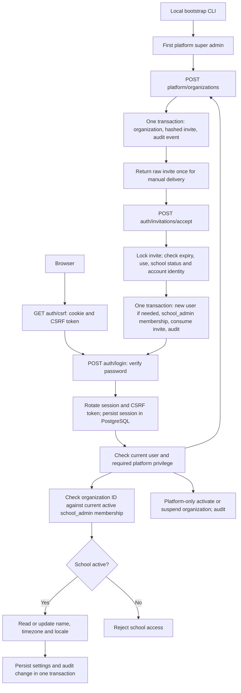

# EDOPS Backend

Milestones 1 and 2 of the B2B school SaaS. One NestJS application, PostgreSQL and explicit
TypeORM migrations. Schools are tenants; users have memberships in schools.
Platform privileges are separate from school roles.

**API references:** [M2 academics and roster](docs/MILESTONE-2.md) documents the new
`/api/v1` routes. [M1 compatibility reference](docs/API.md) explains onboarding inputs,
responses, permissions, internal function calls, database effects and errors.
The running API exposes interactive Swagger at `/api/docs` and OpenAPI JSON at
`/api/docs-json` in non-production environments.

## Run Locally

Requirements: Node.js 22.14+ and PostgreSQL 15+ (or Docker Compose).
Run these commands from `backend/`:

```sh
npm ci
npm run env:init
docker compose up -d --wait postgres
npm run db:migrate
npm run bootstrap:admin -- owner@your-company.com
npm run start:dev
```

Bootstrap prompts for a hidden 12-128 character password. Use your real owner
email; no default administrator or password is created. The CLI refuses to
create a second platform administrator or promote an existing account. It also
accepts the password through stdin, never as a command-line argument.

The API listens at `http://127.0.0.1:3001/api/health`; interactive API documentation
is at `http://127.0.0.1:3001/api/docs`. `start:dev` watches TypeScript source.
For compiled execution, use `npm run build` then `npm start`.

`env:init` creates an ignored `.env` with a random session secret and leaves
existing files unchanged. The example database credentials are local-only.
Compose creates `edops` and `edops_test` on first volume initialization and binds
PostgreSQL to loopback port 15432. Never reuse these credentials in production.

For an existing PostgreSQL installation, skip Compose. Create `edops` and
`edops_test` databases and set `DATABASE_URL` / `TEST_DATABASE_URL` in `.env`.
Do not start Compose if another development database already occupies 15432.
Schema synchronization is disabled; run migrations before starting the API.
The API does not run migrations automatically.

## Request Flow



The diagram omits the `/api` prefix. Every write also requires a CSRF token.

1. Fetch `GET /api/auth/csrf` with `credentials: 'include'`. Keep the returned
   `csrfToken` in memory; the browser retains the HTTP-only cookie.
2. Send `X-CSRF-Token` and `credentials: 'include'` on every POST/PATCH, including
   login and invitation acceptance. Login returns a **replacement** token.
3. The platform admin creates an organization. Deliver the returned invitation
   token privately to the specified school administrator; it expires in 48 hours.
4. In a separate browser session, the new admin accepts with the token and a
   12-128 character password, then logs in. There is no public registration.
5. Existing users must log in with the invited account and accept **without** a
   password. The invite grants a school membership, not control of the account.
6. Use the organization IDs returned by `/auth/me` for school requests. IDs,
   slugs and client-supplied headers never grant authorization by themselves.

In Swagger, fetch `/auth/csrf`, enter its token in **Authorize > csrf**, then
execute login and replace the token with the new value returned by login.
Use the same browser hostname throughout. The session cookie is browser-managed.
Swagger is disabled in production.

## API Surface

All paths below are relative to `/api`.

| Method | Path | Access |
| --- | --- | --- |
| GET | `/health` | Public database connectivity check |
| GET | `/auth/csrf` | Public session-bound CSRF token |
| POST | `/auth/login` | Credentials + CSRF |
| GET | `/auth/me` | Signed-in user; permitted memberships |
| POST | `/auth/logout` | Signed-in user + CSRF; revoke current session |
| POST | `/auth/invitations/accept` | Valid invite + CSRF; existing account requires login |
| POST | `/platform/organizations` | Platform administrator |
| PATCH | `/platform/organizations/:id/status` | Platform administrator |
| GET | `/organizations/:id` | Active school administrator in that school |
| PATCH | `/organizations/:id` | Active school administrator in that school |

Create-school body:

```json
{
  "name": "Example School",
  "slug": "example-school",
  "adminEmail": "admin@school.example",
  "timeZone": "Asia/Kolkata",
  "locale": "en-IN"
}
```

`timeZone` and `locale` have the defaults above. Settings updates accept only
`name`, `timeZone` and `locale`; unknown fields, nulls and empty changes fail.
Supported locales are `en-IN`, `hi-IN`, `en-US`. Status changes accept only
`{"status":"active"}` or `{"status":"suspended"}`. Locale is stored configuration,
not a claim that translated UI or course content is implemented.

## Security Boundaries

- Passwords use Node's scrypt with random salts. Invite tokens are random,
  SHA-256 hashed in invitations and single-use. M2 replay responses also contain
  tokens, encrypted with AES-256-GCM for 24-hour idempotency. Acceptance locks the
  school then invitation, matching the revocation lock order.
- Sessions live in PostgreSQL, use HTTP-only SameSite=Lax cookies and expire
  after eight hours without sliding authentication expiry. Login regenerates
  the session and CSRF token; logout deletes the session. Cookie signing uses
  `SESSION_SECRET`; changing it invalidates existing cookies.
- Current user activity and school membership/status are read from the database
  on protected requests, not trusted from stale role claims in a cookie.
  Suspended schools remain visible in `/auth/me`, but school endpoints deny access.
- Platform admins can provision and suspend schools. They do not silently bypass
  membership checks on school data. Support impersonation is not implemented.
- Tenant scope is enforced by application authorization and forced PostgreSQL RLS
  on the eight new M2 tables. M1 tables still use application checks only.
  Future school resources must carry an organization ID and scoped queries;
  add equivalent isolation tests for every new module, export and background job.
- School creation, invitation acceptance and settings/status changes include
  their audit event in the same transaction. Audit rows reject UPDATE/DELETE.
  This is not tamper-proof against a database owner: production must use a
  non-owner runtime role without DDL/TRUNCATE privileges and separate migrations.
- CORS allows exact origins, state-changing browser requests reject untrusted
  origins, and all writes require synchronizer CSRF tokens. Helmet is enabled;
  JSON bodies are limited to 16 KB. API responses are not cached.
- Login and invitation acceptance allow 10 requests/minute per source IP per
  route, with a default 120/minute for other controller routes. Proxy headers are
  not trusted by default. School NATs share these limits; tune from pilot traffic.

## Configuration

| Variable | Meaning |
| --- | --- |
| `NODE_ENV` | `development`, `test` or `production` |
| `HOST`, `PORT` | Default `127.0.0.1`, `3001` |
| `DATABASE_URL` | PostgreSQL connection URL |
| `DATABASE_SCHEMA` | Default `public`; identifier validated; custom schema must already exist |
| `DATABASE_SSL` | `true` enables certificate-verified TLS; local default `false` |
| `SESSION_SECRET` | Random secret of at least 32 characters, required |
| `CORS_ORIGINS` | Comma-separated exact origins, required; HTTPS in production |
| `TRUST_PROXY` | Optional trusted proxy IPs/CIDRs; never a blanket boolean/hop count |
| `TEST_DATABASE_URL` | Dedicated database with a name ending in `_test`; tests only |

Production requires HTTPS, the `__Host-edops_session` secure cookie and an exact
proxy allowlist if TLS terminates upstream. Deploy UI and API on the same site
(for example `app.example.com` and `api.example.com`) for SameSite=Lax sessions.
Use a secrets manager, verified database TLS and a least-privilege database role.
App/session database connections use UTC; the organization timezone is for
future display and academic scheduling, not storage of timestamps.

## Verification

```sh
npm run typecheck
npm test
```

Tests use Node's built-in runner and real PostgreSQL, not mocked repositories.
They require `TEST_DATABASE_URL`, create a random temporary schema, apply the
migration, bootstrap through the CLI, run the API on ephemeral loopback ports
and remove only that schema afterward. Test credentials are fictitious and
never provision an administrator in the development database.

Coverage includes two-school isolation, role escalation, settings validation,
suspension and membership revocation, invite expiry/reuse/concurrency,
existing-account protection, transaction rollback, append-only audit records,
session rotation/revocation/expiry, CSRF/origin checks and login throttling.

## Module Ownership and Next Work

Implemented: `auth` owns credentials and sessions; `tenants` owns organizations,
memberships, invites and settings; `audit` records privileged actions.
`common` holds shared request guards/filters; `database` holds schema/migrations.
Other domain folders remain placeholders from the approved structure.

M2 implements the academic structure and teacher/student roster; see its reference
for detailed behavior, runtime-role grants and constraints. Tests create a
temporary non-BYPASSRLS login role, so the isolated test database administrator
must have permission to create/drop roles as well as schemas.

No MongoDB, Redis, LLM service, message bus or microservices are required here.
Before multiple API replicas, replace in-memory rate-limit storage with a shared
store. Before a school pilot, add administrator MFA, account recovery, email
delivery, monitoring, consent/privacy workflows and backup/restore checks.
Teacher/student invites can be revoked/replaced. School-admin onboarding invites
still need an operator recovery process. Teaching workflows, billing, entitlements
and frontend screens belong to later milestones. This is not a production-ready LMS.
