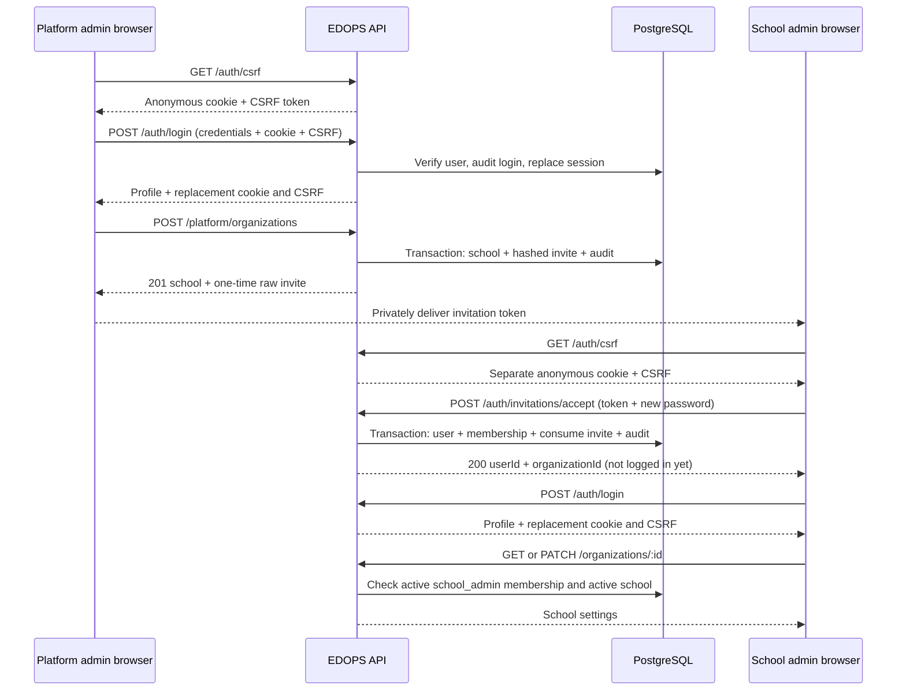
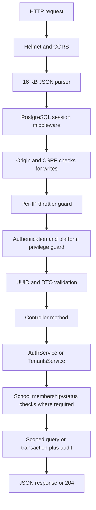

# EDOPS API Reference

This is the **Milestone 1 compatibility reference**. The canonical prefix is now
`/api/v1`; the original `/api` M1 routes remain supported aliases. See
[Milestone 2](MILESTONE-2.md) for the 28 new academic/roster operations, idempotency,
RLS boundaries and implementation decisions. [Milestone 3](MILESTONE-3.md) adds
teaching workflows and resource-scoped teacher/student access.
[Milestone 4](MILESTONE-4.md) adds timeline, in-app notifications and recordings.
[Milestone 5](MILESTONE-5.md) adds objective Arena practice and scorecard metrics.
[Milestone 6](MILESTONE-6.md) adds platform billing and statistics, optional-feature
entitlements and teacher/student seat enforcement. M1 onboarding creates an implicit
30-day school trial; no payment is taken or explicit subscription row created.
Examples use fictitious data.

- Local base URL: `http://127.0.0.1:3001/api`
- Interactive Swagger: [Open API documentation](http://127.0.0.1:3001/api/docs)
- OpenAPI JSON for Postman/API clients: [OpenAPI specification](http://127.0.0.1:3001/api/docs-json)
- Setup and configuration: [Backend README](../README.md)

Swagger and its JSON endpoint are disabled when `NODE_ENV=production`.
The API itself remains available at the configured host and port.

## Contents

- [Quick Reference](#quick-reference)
- [Authentication and Permissions](#authentication-and-permissions)
- [End-to-End Onboarding](#end-to-end-onboarding)
- [Endpoint Reference](#endpoint-reference)
- [Shared Response Models](#shared-response-models)
- [Errors and Retry Rules](#errors-and-retry-rules)
- [Frontend Integration](#frontend-integration)
- [Internal Flow and Audit](#internal-flow-and-audit)
- [Current Limits](#current-limits)

## Quick Reference

There are **10 M1 operations on 9 paths**. All paths in this table include `/api`
and are also available under `/api/v1`.

| Method | Path | Purpose | Who can call | Success |
| --- | --- | --- | --- | --- |
| GET | `/api/health` | Check API/database connectivity | Public | 200 |
| GET | `/api/auth/csrf` | Prepare a session-bound CSRF token | Public | 200 |
| POST | `/api/auth/login` | Verify credentials and start a signed-in session | Existing active user | 200 |
| GET | `/api/auth/me` | Read your profile and school memberships | Signed-in active user | 200 |
| POST | `/api/auth/logout` | Revoke the current session | Signed-in active user | 204 |
| POST | `/api/auth/invitations/accept` | Become an invited school administrator | Invite holder; existing account must be signed in | 200 |
| POST | `/api/platform/organizations` | Create a school and first admin invite | Platform super admin | 201 |
| PATCH | `/api/platform/organizations/:id/status` | Activate/suspend a school | Platform super admin | 200 |
| GET | `/api/organizations/:id` | Read your school settings | Active school admin in an active school | 200 |
| PATCH | `/api/organizations/:id` | Update your school settings | Active school admin in an active school | 200 |

All POST/PATCH requests need the session cookie **and** `X-CSRF-Token`.
There are no supported query parameters or pagination in this milestone.
`:id` is an organization UUID, not a slug or a user ID.

## Authentication and Permissions

### Cookies, Not JWTs

The backend uses a signed HTTP-only cookie pointing to a session in PostgreSQL.
Do not send a Bearer token. Do not store credentials or session cookies in
localStorage, and do not try to read the HTTP-only cookie from JavaScript.

| Item | Behavior |
| --- | --- |
| Development/test cookie | `edops_session` |
| Production cookie | `__Host-edops_session`; HTTPS required |
| Cookie attributes | HTTP-only, SameSite=Lax, Path=/; Secure in production |
| Authentication lifetime | At most 8 hours from successful login; reads do not renew it |
| Session storage | PostgreSQL `sessions` table; session ID, JSON state and expiry |
| CSRF header | `X-CSRF-Token`, matching the token for the same session |
| Browser requests | Set `credentials: 'include'` |
| Origin | A supplied Origin on writes must exactly match `CORS_ORIGINS` |

Before the first write, fetch `/api/auth/csrf`. Login replaces both the anonymous
session and the CSRF token. Always retain the replacement token from login.
Logout invalidates the current cookie; fetch a new CSRF token before logging in
again. Keep one hostname throughout: `localhost` and `127.0.0.1` have different
cookie scopes. Deploy UI and API on the same site for SameSite=Lax cookies.

"Public" means no signed-in user is required. It does **not** exempt a write
endpoint from CSRF checks. Omitting Origin, as a CLI client can, does not bypass
the session-bound CSRF requirement.

### Two Separate Permission Levels

- `users.is_platform_admin`: product-owner privilege for explicit `/platform/*`
  operations. It does not automatically grant access to school settings.
- `memberships`: `(organization_id, user_id)` with a school role and status.
  The current school APIs require `role=school_admin` and `status=active`.
- `organizations.status`: must be `active` for school settings and invitation
  acceptance. Suspension does not remove the user account or membership.

M2 now provisions `teacher` and `student` memberships. `parent` provisioning and
teacher/student learning APIs are not implemented. A teacher membership does not
authorize school-admin settings or academic-management endpoints.

Every protected request rechecks the current user. School requests additionally
check membership and organization status from PostgreSQL. A URL ID, slug or
tenant header cannot grant access. An active school admin asking for another
school receives `404`, concealing whether that school exists.

## End-to-End Onboarding

### First Platform Administrator

From `backend/`, after applying migrations:

```sh
npm run bootstrap:admin -- owner@your-company.com
```

Enter a hidden 12-128 character password when prompted. This is a local CLI,
**not an HTTP registration endpoint**. It creates the first platform admin and
`user.bootstrap` audit event in a transaction protected by an advisory lock.
It refuses a second platform admin and refuses to promote an existing account.
There are no default credentials.

### School Onboarding Sequence



The sequence omits the `/api` prefix. A school admin whose email already belongs
to an account logs in **before** accepting and omits `password` during acceptance.

### Trying This in Swagger or Postman

1. Call `GET /api/auth/csrf`. In Swagger, enter the returned value in
   **Authorize > csrf**. Let the browser manage the cookie; the cookie scheme in
   the specification describes that requirement, not a token to paste manually.
2. Call `POST /api/auth/login` with the platform admin's email and password.
   Replace the authorized CSRF value with the new value returned by login.
3. Call `POST /api/platform/organizations` and privately deliver the returned
   invitation. No delivery email is sent by this API.
4. Use another browser profile/private window for the school admin. Start with
   its own CSRF request; accept the invitation and log in as described above.
5. Use the returned organization UUID to read/update settings. The owner cannot
   use school settings endpoints without a separate school membership.

Postman can import `/api/docs-json`. Enable its cookie jar and set the
`X-CSRF-Token` header to the token returned for that same jar. Cookies and CSRF
tokens from different browser/client sessions cannot be mixed.

## Endpoint Reference

JSON bodies require `Content-Type: application/json` and are limited to 16 KB.
Examples below are illustrative: replace IDs, tokens and passwords with values
from your own local workflow. Success responses are direct JSON objects,
**not** `{ "data": ... }` envelopes. Logout has no response body.

All controller routes may return `429` or `500`; see the shared error section.
Write requests may also fail with `403` for CSRF/origin or `413` for body size.
The lists below add endpoint-specific failures, not a promise of validation order.

### 1. GET /api/health

**Purpose:** check that the API can query its configured database.
**Access:** public; no body, login or CSRF header. Limit: 120/minute per IP.

**How:** `HealthController.health()` runs `SELECT 1`. It does not verify that all
migrations have run, check every table or check external services. No domain
rows are changed and no audit event is written.

**200 response:**

```json
{ "status": "ok", "database": "up" }
```

**Failures:** `503` when the health query fails. Middleware/storage failures
before the controller may instead return `500`.

### 2. GET /api/auth/csrf

**Purpose:** prepare a browser or API client to make writes.
**Access:** public; no body or prior login. Limit: 120/minute per IP.

**How:** `AuthController.csrfToken()` calls `csrf.generateToken(request)`.
A new anonymous session is stored in `sessions` when necessary and its signed
HTTP-only cookie is set. An existing token is reused; this endpoint does not
sign the user in or refresh the authentication deadline. No audit event.

**200 response:**

```json
{ "csrfToken": "example-only-csrf-token" }
```

Treat the token as opaque, not as an access token or an invitation token.
Send it on writes in `X-CSRF-Token`, together with the cookie from this session.

### 3. POST /api/auth/login

**Purpose:** authenticate an existing user and establish a signed-in session.
**Access:** no prior login, but anonymous cookie + CSRF required. Limit: 10/minute
per IP, including successful logins and invalid credentials.

| Field | Required | Validation |
| --- | --- | --- |
| `email` | Yes | Valid email, maximum 254 characters; trimmed and lowercased |
| `password` | Yes | String, 1-128 characters; not trimmed |

The login boundary accepts 1-128 characters for verification; creation through
bootstrap/invites requires 12-128 characters. Unknown fields fail validation.

```json
{ "email": "admin@school.example", "password": "example-only-password" }
```

**How:** `AuthController.login()` calls `AuthService.verifyCredentials()` to
look up the user and verify the scrypt password. An unknown email still incurs
password derivation work; unknown email, wrong password and inactive user all
return the same credential error. It records `auth.login`, regenerates the
session, stores `userId` and `authenticatedAt`, saves the replacement CSRF token,
then calls `AuthService.profile()` for current memberships.

**200 response:** a [Profile](#profile), plus `csrfToken`, and a replacement
session cookie. The prior cookie and token must no longer be used.

```json
{
  "user": {
    "id": "22222222-2222-4222-8222-222222222222",
    "email": "admin@school.example",
    "isPlatformAdmin": false
  },
  "organizations": [
    {
      "id": "11111111-1111-4111-8111-111111111111",
      "name": "Example School",
      "slug": "example-school",
      "status": "active",
      "role": "school_admin"
    }
  ],
  "csrfToken": "example-only-replacement-csrf-token"
}
```

**Failures:** `400` invalid fields; `401` invalid email/password or inactive
account. A suspended school does not prevent a user's login, but that school's
settings endpoints remain denied. Login is not atomic with its audit event:
session creation may fail after credential verification was audited.

### 4. GET /api/auth/me

**Purpose:** restore the signed-in user and permitted organization choices.
**Access:** active authenticated user; no body or CSRF header. Limit: 120/minute
per IP.

**How:** `AuthGuard` checks session lifetime and user activity through
`AuthService.currentUser()`. `AuthController.me()` calls `AuthService.profile()`
to join organizations with that user's **active memberships**, ordered by school
name. It is not a user directory or a platform-wide school list.

**200 response:** the [Profile](#profile), without `csrfToken`. Suspended
schools stay listed with `status=suspended`; inactive memberships disappear.
An empty `organizations` array is valid, including for the platform owner.
No domain writes or audit event.

**Failures:** `401` absent, expired or revoked session, or inactive user.

### 5. POST /api/auth/logout

**Purpose:** sign out of the current session only.
**Access:** active authenticated user + CSRF. Limit: 120/minute per IP.
**Request body:** none.

**How:** `AuthController.logout()` deletes the current session, clears its cookie,
then `AuthService.recordLogout()` records `auth.logout`. Other device sessions,
the user account and memberships are unchanged.

**204 response:** empty body. Do not call `response.json()` for this response.
Forget the old client-side CSRF token. To log in again, start with `/auth/csrf`.

**Failures:** `401` if authentication is already absent/expired; `403` if the
CSRF token no longer matches. Repeating logout after revocation is not guaranteed
to return another `204`. If audit storage fails after deletion, the request may
return `500` even though the session has already been revoked.

### 6. POST /api/auth/invitations/accept

**Purpose:** grant the role stored on the invite: `school_admin` for platform
onboarding, or `teacher`/`student` for M2 roster invitations.
**Access:** valid invite + cookie + CSRF. Limit: 10/minute per IP.

| Field | Required | Validation |
| --- | --- | --- |
| `token` | Yes | Exactly 64 lowercase hexadecimal characters from the real invitation |
| `password` | New account only | String, 12-128 characters; omit entirely for existing accounts |

**New account:** use a signed-out session and supply a password.

```json
{
  "token": "aaaaaaaaaaaaaaaaaaaaaaaaaaaaaaaaaaaaaaaaaaaaaaaaaaaaaaaaaaaaaaaa",
  "password": "example-only-new-password"
}
```

**Existing account:** sign in with the invited email and omit `password`.

```json
{ "token": "aaaaaaaaaaaaaaaaaaaaaaaaaaaaaaaaaaaaaaaaaaaaaaaaaaaaaaaaaaaaaaaa" }
```

The `a...a` example is not a real invitation. Do not send `email`, `role`,
`organizationId` or `isPlatformAdmin`; the server derives scope from the invite.

**How:** `InvitationsController.accept()` gets the optional signed-in user and
calls `TenantsService.acceptInvitation()`. In one transaction it:

1. Hashes the token and locates a matching unaccepted, unexpired, unrevoked invite.
2. Locks the active school first, then rechecks and locks the invite. This lock
   order is shared with M2 revocation and avoids an inverted-lock deadlock.
3. For an existing user, verifies the session belongs to that active account and
   refuses any password field. For a new user, requires a signed-out session and
   creates a user with a scrypt password hash and no platform privilege.
4. Inserts the role stored on the invite, sets `accepted_at`, and records
   `invitation.accepted` with the invitation ID in audit details.

**200 response:**

```json
{
  "userId": "22222222-2222-4222-8222-222222222222",
  "organizationId": "11111111-1111-4111-8111-111111111111"
}
```

New users are **not automatically logged in**: call `/auth/login` next. Existing
users keep their current session and can refresh `/auth/me` to see the membership.

**Failures:** `400` malformed/expired/revoked/already-used token, missing new password,
or password supplied for an existing account; `403` unavailable school, wrong
signed-in account, or signed-in user attempting new-account creation; `409`
uniqueness conflict such as an existing membership or concurrent account creation.
Failed transactions do not leave partial users/memberships or consume the invite.
Parallel acceptance of the same token permits at most one successful acceptance.

### 7. POST /api/platform/organizations

**Purpose:** onboard a new school organization and invite its first administrator.
**Access:** active platform super admin + CSRF. Limit: 120/minute per IP.

| Field | Required | Validation/default |
| --- | --- | --- |
| `name` | Yes | Trimmed, nonblank string, maximum 120 characters |
| `slug` | Yes | Unique, maximum 63 characters; `^[a-z0-9]+(?:-[a-z0-9]+)*$` |
| `adminEmail` | Yes | Valid email, maximum 254 characters; trimmed/lowercased |
| `timeZone` | No | Valid IANA timezone, maximum 100 characters; default `Asia/Kolkata` |
| `locale` | No | `en-IN`, `hi-IN` or `en-US`; default `en-IN` |

Omit optional fields to use defaults; `null` is invalid. Slugs are not trimmed
or lowercased for you. Unknown fields such as `status` or `plan` fail validation.

```json
{
  "name": "Example School",
  "slug": "example-school",
  "adminEmail": "admin@school.example",
  "timeZone": "Asia/Kolkata",
  "locale": "en-IN"
}
```

**How:** `PlatformOrganizationsController.create()` passes validated input to
`TenantsService.create()`. One transaction inserts an active organization, a
48-hour invitation with only its SHA-256 token hash, and `organization.created`.
No user, membership, subscription or invoice is created at this stage.

**201 response:** [Organization](#organization) plus a one-time invitation:

```json
{
  "organization": {
    "id": "11111111-1111-4111-8111-111111111111",
    "name": "Example School",
    "slug": "example-school",
    "timeZone": "Asia/Kolkata",
    "locale": "en-IN",
    "status": "active",
    "createdAt": "2026-09-08T09:00:00.000Z",
    "updatedAt": "2026-09-08T09:00:00.000Z"
  },
  "invitation": {
    "token": "aaaaaaaaaaaaaaaaaaaaaaaaaaaaaaaaaaaaaaaaaaaaaaaaaaaaaaaaaaaaaaaa",
    "email": "admin@school.example",
    "expiresAt": "2026-09-10T09:00:00.000Z"
  }
}
```

Deliver the real token privately. It is returned only once, not emailed,
logged or retrievable through a current API. A lost response may leave a created
school whose invitation cannot be recovered via this endpoint.

**Failures:** `400` invalid fields; `401` not signed in; `403` not a platform
admin; `409` duplicate slug or another unique constraint. Repeating the request
is not an invitation-resend operation. If any transaction step fails, school,
invite and audit inserts all roll back.

### 8. PATCH /api/platform/organizations/:id/status

**Purpose:** enable or suspend a school's service access.
**Access:** active platform super admin + CSRF. Limit: 120/minute per IP.
**Path parameter:** `id`, an organization UUID.

```json
{ "status": "suspended" }
```

Only `active` and `suspended` are accepted. To restore access, send `active`.

**How:** `PlatformOrganizationsController.setStatus()` calls
`TenantsService.setStatus()`, locks the organization for writing, saves status,
and records `organization.status_changed` with `before`/`after` in one transaction.

**200 response:** the full [Organization](#organization), with the resulting
`status`. Suspension denies subsequent school settings requests and invitation
acceptance. It does not delete data, revoke every session, hide the school from
`/auth/me`, or automatically stop billing. Other schools are unaffected.

**Failures:** `400` malformed UUID or status; `401` no authentication; `403`
not platform admin; `404` organization does not exist.
Setting the same status again still creates an audit event, so retries are not
side-effect-free. Already-running requests are not forcibly cancelled.

### 9. GET /api/organizations/:id

**Purpose:** retrieve the settings of a school you administer.
**Access:** active user with an active `school_admin` membership in an active
organization. No body or CSRF header. Limit: 120/minute per IP.

**How:** `OrganizationsController.get()` calls `TenantsService.get()` and its
shared `authorizedOrganization()` check. Membership is resolved using **both**
the path organization ID and authenticated user ID. Then role and organization
status are checked. No domain writes or audit event.

**200 response:** the full [Organization](#organization). Does not include a
teacher/student directory, invite tokens, billing, classes or statistics.

**Failures:** `400` malformed UUID; `401` no valid authentication; `404` no active
membership or no such school; `403` wrong school role or suspended school.
Platform privilege alone is not a bypass.

### 10. PATCH /api/organizations/:id

**Purpose:** change supported settings for your own school.
**Access:** same active school-admin checks as GET, plus CSRF. Limit: 120/minute
per IP. `id` is the organization UUID.

| Field | Required | Validation |
| --- | --- | --- |
| `name` | At least one of these fields | Trimmed nonblank string, maximum 120 characters |
| `timeZone` | At least one of these fields | Valid IANA timezone, maximum 100 characters |
| `locale` | At least one of these fields | `en-IN`, `hi-IN` or `en-US` |

```json
{ "name": "Example School - Main Campus", "locale": "en-US" }
```

Omitted fields keep their current value. Empty `{}`, `null`, whitespace-only
names and unknown fields are rejected. You cannot change `slug`, `status`,
`adminEmail`, membership roles, tenant IDs, billing or platform privileges here.

**How:** `OrganizationsController.update()` calls `TenantsService.update()`.
After checking that a supported setting was supplied, a transaction checks
authorization, locks the organization, updates only those three supported fields,
and records `organization.updated` with before/after settings.

**200 response:** the full [Organization](#organization) after the update.
`createdAt` is preserved. `updatedAt` advances when the ORM changes the row;
submitting the same values still records an audit event even if no row changed.

**Failures:** `400` invalid UUID, empty/invalid/extra fields; `401` no valid
authentication; `404` no active membership or missing school; `403` wrong role
or suspended school. Audit failure rolls back a settings change.

## Shared Response Models

### Organization

Returned directly by school GET/PATCH and platform status PATCH; nested under
`organization` in the create-school response.

```json
{
  "id": "11111111-1111-4111-8111-111111111111",
  "name": "Example School",
  "slug": "example-school",
  "timeZone": "Asia/Kolkata",
  "locale": "en-IN",
  "status": "active",
  "createdAt": "2026-09-08T09:00:00.000Z",
  "updatedAt": "2026-09-08T09:00:00.000Z"
}
```

IDs are strings containing UUIDs. Timestamps are ISO-8601 instants; app/database
connections use UTC. `timeZone` and `locale` are stored school configuration,
not evidence of implemented academic scheduling or translated course content.

### Profile

Returned by `/auth/me`; login adds a `csrfToken` field to this object.

```json
{
  "user": {
    "id": "22222222-2222-4222-8222-222222222222",
    "email": "admin@school.example",
    "isPlatformAdmin": false
  },
  "organizations": [
    {
      "id": "11111111-1111-4111-8111-111111111111",
      "name": "Example School",
      "slug": "example-school",
      "status": "active",
      "role": "school_admin"
    }
  ]
}
```

`role` describes this user's membership in that school. It is not a global role.
Multiple active memberships are supported. `organizations` may be empty.
Responses never expose `passwordHash`, the database session ID or invitation hashes.

## Errors and Retry Rules

Application errors have `statusCode` and `message`; `message` is a string or an
array of validation messages. An `error` label is sometimes present, so clients
must not require it. There is no stable application-specific error-code field.

```json
{ "statusCode": 403, "message": "Invalid or missing CSRF token" }
```

```json
{
  "statusCode": 400,
  "message": ["property role should not exist"],
  "error": "Bad Request"
}
```

| Status | Meaning | Client action |
| --- | --- | --- |
| 400 | Invalid JSON/UUID/fields or business input, including expired/used invite | Correct input; do not retry unchanged |
| 401 | Invalid credentials or absent/expired/revoked/inactive-user authentication | Reauthenticate when appropriate; do not assume only session expiry |
| 403 | CSRF/origin failure, forbidden role/account, or suspended school | Check message and account context; a new token does not fix a role denial |
| 404 | Missing school or concealed lack of membership | Do not treat a typed-in tenant ID as authorization |
| 409 | Unique constraint conflict | Resolve duplicate/conflicting data; do not blindly retry creation |
| 413 | JSON body larger than 16 KB | Reduce the body; file upload is not supported here |
| 429 | Per-IP route limit | Respect `Retry-After` before retrying |
| 500 | Unexpected server/storage failure | Report failure without logging secrets; investigate write outcome before retrying |
| 503 | Health database query failed | Check database availability |

Processing order matters: origin/CSRF middleware runs before controller guards
and DTO validation. For example, a malformed write with no CSRF may return `403`
before `400`, and a repeated logout may fail CSRF before reaching authentication.

Rate limits are per route and source IP in a single process, not per user or
school. School users behind the same NAT share a bucket. Controller defaults
are 120/minute; login and invite acceptance are 10/minute. Shared limit storage
is needed before multiple replicas. Trusted proxy configuration affects source
IP detection; arbitrary forwarded headers are ignored by default.

M1 writes do not implement idempotency keys; M2 creation endpoints require them.
A network timeout does not prove a
transaction failed. Creation may already have committed; acceptance may already
have consumed an invite; repeated settings/status requests create more audit
events. Do not implement automatic write retries without reconciling the outcome.

## Frontend Integration

This example belongs in browser-side code on a trusted configured origin. It
keeps CSRF in memory, sends the HTTP-only cookie through the browser, accepts the
replacement login token and handles the empty logout response. It does not retry
writes. Server-side Next.js calls need explicit cookie forwarding instead.

```js
const API = 'http://127.0.0.1:3001/api';
let csrfToken;

async function request(path, { method = 'GET', body } = {}) {
  const headers = {};
  if (body !== undefined) headers['Content-Type'] = 'application/json';
  if (method !== 'GET') headers['X-CSRF-Token'] = csrfToken ?? '';

  const response = await fetch(`${API}${path}`, {
    method,
    credentials: 'include',
    headers,
    body: body === undefined ? undefined : JSON.stringify(body),
  });
  const data = response.status === 204 ? null : await response.json();
  if (!response.ok) {
    const message = Array.isArray(data.message) ? data.message.join('; ') : data.message;
    throw new Error(`${response.status}: ${message}`);
  }
  if (data?.csrfToken) csrfToken = data.csrfToken;
  if (path === '/auth/logout') csrfToken = undefined;
  return data;
}

await request('/auth/csrf');
// email/password come from the sign-in form, never hardcoded application secrets.
const profile = await request('/auth/login', {
  method: 'POST', body: { email, password },
});
const current = await request('/auth/me');
await request('/auth/logout', { method: 'POST' });
```

The API does not currently offer a bearer-token or API-key integration flow.
Never place invitation tokens or passwords in query strings, analytics events,
application logs or shared screenshots. Raw invitations are deliberately returned
only to the authorized platform admin for manual delivery.

## Internal Flow and Audit



Public handlers skip signed-in-user checks, not CSRF or throttling. Swagger
routes are development tooling outside this business-controller flow.

| Action | Trigger/function | Domain changes | Audit |
| --- | --- | --- | --- |
| Bootstrap | `bootstrapAdmin()` in auth service, called by CLI | Insert platform user | `user.bootstrap`, same transaction |
| Login | `verifyCredentials()` then controller session replacement | Replace current session | `auth.login` after credential verification, outside session transaction |
| Logout | Controller destroy then `recordLogout()` | Delete current session | `auth.logout` after deletion, separate write |
| Create school | `TenantsService.create()` | Insert school and hashed invite | `organization.created`, same transaction |
| Accept invite | `TenantsService.acceptInvitation()` | Optional new user, membership, consume invite | `invitation.accepted`, same transaction; invitation ID in details |
| Update settings | `TenantsService.update()` | Update supported school settings | `organization.updated`, same transaction; before/after settings |
| Change status | `TenantsService.setStatus()` | Update active/suspended status | `organization.status_changed`, same transaction; before/after status |

CSRF, health, profile and school reads produce no audit events. Failed-login and
denied-request audit events are not implemented. Sessions may still be read or
created by middleware; "no domain writes" does not mean no session activity.

Audit entries have `organization_id` (nullable for platform/auth actions),
`actor_id`, `action`, JSON `details` and `created_at`. Passwords, raw invite tokens
and cookies are not included. A trigger rejects ordinary UPDATE/DELETE, but a
database owner can bypass it; this is not an immutable external audit archive.
There is no public audit-list endpoint in this milestone.

### Source Map

- [Application setup](../src/app.ts): cookies, CORS, CSRF, validation, error filter and Swagger.
- [Application module](../src/app.module.ts): health controller and global guards.
- [Authentication guard](../src/common/auth.guard.ts): current-user and platform checks.
- [Authentication controller](../src/modules/auth/auth.controller.ts): CSRF/login/me/logout.
- [Authentication service](../src/modules/auth/auth.service.ts): session store, credentials, profile and bootstrap.
- [School/invitation controllers](../src/modules/tenants/tenants.controller.ts): route entry points.
- [School service](../src/modules/tenants/tenants.service.ts): scope checks and onboarding/settings transactions.
- [Request DTOs](../src/modules/tenants/tenant.dto.ts): school and invite validation.
- [Initial migration](../src/database/migrations/1788825600000-InitialSchema.ts): tables, constraints and audit trigger.
- [Integration tests](../test/milestone1.test.cjs): real PostgreSQL security and contract checks.

## Current Limits

M2 adds teacher/student invitations and membership status management, academic
years, programs/grades, subjects, sections, teacher assignments and enrollments.
See [M2 reference](MILESTONE-2.md). There are no learning APIs yet for attendance,
homework assignments, scorecards, Arena, recorded content, reports, billing,
subscriptions, feature entitlements, organization listing, audit listing,
support impersonation or arbitrary tenant configuration.

There is no public signup, MFA, password recovery, password-change endpoint,
invitation email delivery or revoke-all-sessions endpoint. School admins can revoke
and replace teacher/student invites; platform-onboarding admin invites still lack
a resend/revoke endpoint. Those lost/expired admin invites need operator recovery.
No promise is made that future billing pauses automatically with school status.

The eight new M2 tables use forced PostgreSQL row-level security with a scoped
transaction manager. Original M1 tables still rely on application authorization.
These authorization checks and tests must be carried into every future school
resource, export and background job. The next milestone should extend this
foundation, not assume that placeholder domain folders already implement APIs.
