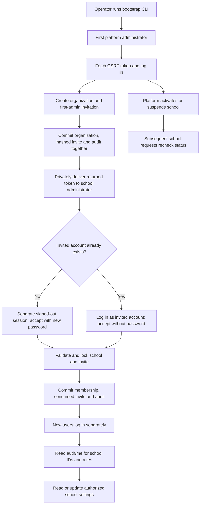
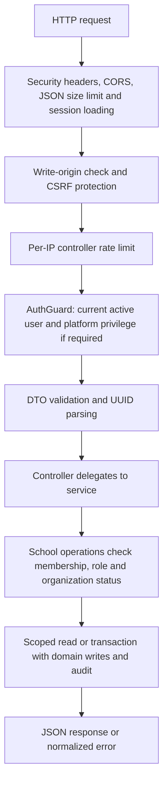
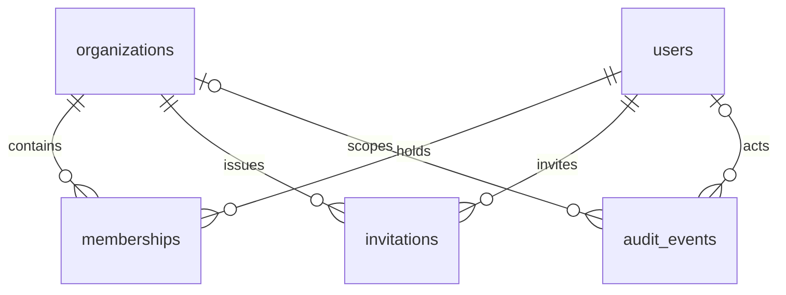

# Milestone 1: Identity and School Onboarding

Milestone 1 establishes the backend foundation for EDOPS, a B2B multi-tenant
service sold to schools and organizations. The platform owner provisions a
school; its administrator accepts an invitation and manages that school's
settings. Students and teachers are not individual SaaS customers.

This guide describes the implemented M1 workflow on the current branch, which
also includes M2. It is not a claim that the complete LMS or production rollout
is finished. See [API.md](API.md) for detailed request/response models and
[Milestone 2](MILESTONE-2.md) for academics and teacher/student provisioning.

## Delivered Scope

| Capability | Implemented behavior |
| --- | --- |
| Platform owner | CLI bootstrap creates the first super admin; no default credentials |
| Authentication | Password login, PostgreSQL sessions, current profile and logout |
| School onboarding | Platform admin creates an active organization and first-admin invitation |
| Invitation acceptance | Creates a new account when needed and grants a school membership |
| Tenant settings | School admin reads/updates their school's name, timezone and locale |
| Platform control | Activate or suspend an organization without deleting its data |
| Audit | Records bootstrap, login/logout, onboarding and settings/status changes |
| Developer support | Explicit migrations, Swagger, API reference and PostgreSQL integration tests |

No public signup, frontend screens, subscription billing, feature entitlements,
attendance, assignments, scorecards, recorded classes or AI service are part of M1.

## Local Setup

Requirements: Node.js 22.14+ and PostgreSQL 15+ or Docker Compose.
From `backend/`, for a new local environment:

```sh
npm ci
npm run env:init
docker compose up -d --wait postgres
npm run db:migrate
npm run bootstrap:admin -- owner@your-company.com
npm run start:dev
```

Bootstrap reads a hidden 12-128 character password or stdin, never a password
argument. It refuses a second platform administrator and refuses to promote an
existing account. Skip bootstrap when the owner already exists.

`env:init` creates an ignored `.env` with a random session secret and preserves
an existing file. Compose uses local-only credentials, binds to loopback port
15432 and initializes `edops` and `edops_test` on the first volume initialization.
With an existing PostgreSQL server, skip Compose, create those databases and
configure their URLs. Do not start a second database on an occupied port.

Run all pending migrations on the current branch, including M2. Current invite
acceptance uses columns added by M2, so applying only the historical M1 migration
is not sufficient. Schema synchronization and automatic startup migrations are
disabled. Migration rollback can destroy data; it is not an onboarding reset.

- Canonical API base: `http://127.0.0.1:3001/api/v1`.
- Original M1 routes remain available under `/api` as compatibility aliases.
- Swagger: `http://127.0.0.1:3001/api/docs`.
- OpenAPI JSON: `http://127.0.0.1:3001/api/docs-json`.
- Swagger and OpenAPI are disabled in production.

See [backend configuration](../README.md#configuration) for all environment
variables. Never commit `.env`, production credentials or real invitation tokens.

## Onboarding Flow



1. Fetch `/auth/csrf`. Preserve the session cookie and keep `csrfToken` in memory.
2. Send the cookie and `X-CSRF-Token` on login. Login rotates both session and
   CSRF token; replace the saved token with the response value.
3. As platform admin, create the school with its first administrator's email.
   Creation returns the organization and raw invitation token; no email is sent.
4. Deliver the token privately. It expires after 48 hours and is single-use.
5. Accept from the invited person's session, not the owner's session. A new
   account supplies a password while signed out. An existing account must log in
   as the invited email and omit the password. Acceptance cannot reset a password.
6. Acceptance returns `userId` and `organizationId`. It does not sign in a newly
   created user or grant platform privilege. Log in separately for school access.
7. Choose a school from `/auth/me`. Its UUID selects scope, but membership and
   school status determine authorization on the server.

Browser requests use `credentials: 'include'`. Use one hostname throughout;
`localhost` and `127.0.0.1` do not share cookies. In Swagger, authorize the CSRF
value before login and replace it afterward. Do not use a bearer token.

## API and Function Map

All paths in this table are relative to `/api/v1`; M1 also supports `/api`.
All POST/PATCH requests require a session-bound CSRF token, including public login
and invitation acceptance. Success responses are direct JSON, not `data` envelopes.

| Method and path | Main function | Access and result |
| --- | --- | --- |
| `GET /health` | `HealthController.health()` | Public; runs `SELECT 1`; `200` connectivity result or `503` |
| `GET /auth/csrf` | `AuthController.csrfToken()` | Public; establishes anonymous session if needed; `200 {csrfToken}` |
| `POST /auth/login` | `AuthService.verifyCredentials()`, controller session rotation, `profile()` | Credentials; `200` profile plus replacement CSRF token |
| `GET /auth/me` | `AuthService.profile()` | Signed in; `200` current user and active school memberships |
| `POST /auth/logout` | Controller session destruction, `AuthService.recordLogout()` | Signed in; revokes current session; `204`, no body |
| `POST /auth/invitations/accept` | `TenantsService.acceptInvitation()` | Valid invite and account checks; `200 {userId,organizationId}` |
| `POST /platform/organizations` | `TenantsService.create()` | Platform admin; `201` organization and private invitation |
| `PATCH /platform/organizations/:id/status` | `TenantsService.setStatus()` | Platform admin; `200` updated organization |
| `GET /organizations/:id` | `TenantsService.get()`, `authorizedOrganization()` | Active school admin; `200` own organization |
| `PATCH /organizations/:id` | `TenantsService.update()`, `authorizedOrganization()` | Active school admin; `200` updated settings |

Example school creation body:

```json
{
  "name": "Example School",
  "slug": "example-school",
  "adminEmail": "admin@school.example",
  "timeZone": "Asia/Kolkata",
  "locale": "en-IN"
}
```

The name is trimmed and limited to 120 characters. The unique slug uses lowercase
letters/digits separated by single hyphens, up to 63 characters. Email is trimmed
and lowercased. `timeZone` defaults to `Asia/Kolkata`; `locale` defaults to `en-IN`.
Supported locales are `en-IN`, `hi-IN`, `en-US`. Locale storage does not implement
translations. Settings PATCH accepts only `name`, `timeZone`, `locale`, with at
least one supplied; nulls, unknown fields and an empty object are rejected.
Status PATCH accepts only `{"status":"active"}` or `{"status":"suspended"}`.

Full payloads, response examples and endpoint errors are in the
[endpoint reference](API.md#endpoint-reference).

## Authorization and Request Processing



Public routes skip the authentication guard, not CSRF protection on writes.
`isPlatformAdmin` is a global user privilege; `school_admin` is a role on a
specific membership. Neither a supplied tenant header nor knowledge of a UUID
grants access. Platform privilege does not bypass school-data membership checks.

Missing or expired authentication returns `401`. A school lookup without an
active membership returns `404`; a wrong school role or suspended organization
returns `403`. `/auth/me` lists active memberships even when the school is
suspended, but school routes reject that status. Suspension does not delete data,
revoke every session or change billing.

M1 tenant isolation is enforced by application checks, not PostgreSQL RLS.
M2 adds forced RLS to its eight new tables only. Do not describe the current
system as having universal database-level tenant isolation.

## Data Model and Ownership



| Table | Purpose and important constraints |
| --- | --- |
| `users` | Global identity, unique normalized email, password hash, active flag and platform privilege |
| `organizations` | Tenant identity, unique slug, settings and active/suspended status |
| `memberships` | Composite primary key `(organization_id,user_id)`; one role/status per user per school |
| `invitations` | School/email-bound token hash, inviter, expiry and acceptance timestamp |
| `sessions` | Session ID, JSON session data and expiry; signed-in user ID is stored in JSON, not a foreign key |
| `audit_events` | Optional school/actor references, action, JSON details and timestamp; UPDATE/DELETE rejected by trigger |

The diagram omits sessions because they have no relational user foreign key.
The historical M1 schema permits `school_admin`, `teacher`, `student`, `parent`
membership roles, but M1 onboarding grants only `school_admin`. Current M2 adds
invitation role, revocation and batch fields; acceptance now honors the stored
role. Parent workflows are not implemented.

- [Auth service](../src/modules/auth/auth.service.ts): credentials, profile,
  current-session user checks, session store and first-owner bootstrap.
- [Tenants service](../src/modules/tenants/tenants.service.ts): organization
  authorization, onboarding, invitation acceptance and settings/status changes.
- [Audit service](../src/modules/audit/audit.service.ts): writes using the caller's
  transaction manager.
- [Application setup](../src/app.ts): middleware, versioning, validation and Swagger.
- [Initial migration](../src/database/migrations/1788825600000-InitialSchema.ts):
  original six tables and audit protection; schema synchronization is disabled.

## Transactions, Audit and Retries

Bootstrap takes an advisory transaction lock and commits the owner with
`user.bootstrap`. School creation commits organization, hashed invitation and
`organization.created` together. Acceptance locks the school before the invite,
rechecks availability and token validity, then commits any new user, membership,
consumed invitation and `invitation.accepted` together.

Settings/status changes lock the school and commit their audit event in the same
transaction: `organization.updated` or `organization.status_changed`, including
before/after values. An audit insertion failure rolls back these domain changes.
Passwords and raw invitation tokens are not audit details.

Login and logout also record `auth.login` and `auth.logout`, but these events are
not atomic with session-store operations. Login audits credential verification
before session persistence; logout destroys the session before recording its
event. An error response therefore does not always mean session state is unchanged.

M1 does not implement idempotency-key replay, even under `/api/v1`. If school
creation succeeds but its response is lost, retrying its slug returns `409` and
cannot recover the raw token. There is no M1 invite resend/replacement endpoint;
an operator recovery process is still needed. Repeating a settings/status PATCH
can add another audit event. See [retry rules](API.md#errors-and-retry-rules).

## Security and Operational Limits

- Passwords use native Node scrypt with random salts. Invitations use 32 random
  bytes encoded as hex; their token hashes use SHA-256.
- Authentication expires at most eight hours after login. Cookies are HTTP-only,
  SameSite=Lax and Secure in production (`__Host-edops_session`). Login rotates
  the session and CSRF token; logout revokes only the current session.
- User activity, membership and school status are checked from PostgreSQL,
  not trusted from client role claims. Reads do not extend authentication expiry.
- JSON bodies are limited to 16 KB. Login and invite acceptance allow 10 requests
  per minute per IP per route; other controller routes default to 120. Limits are
  in-process, so shared rate-limit storage is needed before multiple replicas.
- Audit triggers are not tamper-proof against a database owner and do not replace
  least-privilege grants. Use separate migration and runtime roles, without runtime
  DDL/TRUNCATE privileges. Current production startup rejects superuser/BYPASSRLS
  roles; see [runtime role setup](MILESTONE-2.md#runtime-role-setup).
- Use HTTPS, exact trusted origins/proxies, a secrets manager and verified database
  TLS. Rotating `SESSION_SECRET` invalidates existing signed session cookies and
  also affects M2 encrypted replay data. Do not treat rotation as an isolated M1 change.

## Verification and Troubleshooting

From `backend/`, with a dedicated `TEST_DATABASE_URL` ending in `_test`:

```sh
npm run typecheck
npm test
```

To run only the existing M1 checks against the current schema:

```sh
npm run build
node --env-file-if-exists=.env --test test/milestone1.test.cjs
```

[M1 tests](../test/milestone1.test.cjs) create a random isolated schema, apply both
current migrations, bootstrap test accounts, run the API on ephemeral loopback
ports and clean up the schema. They cover tenant isolation, escalation denial,
settings validation, suspension, invite expiry/reuse/concurrency, existing-account
protection, rollback, audit immutability, session lifecycle, CSRF, throttling and
API documentation. The full suite also creates a temporary least-privilege role
for M2; its test database administrator needs schema and role creation permissions.

| Symptom | Check |
| --- | --- |
| `403` on login/write | Fetch CSRF first, preserve cookies, replace the token after login and check the exact Origin |
| `401` after successful login | Cookie hostname, browser credentials option, eight-hour expiry and current user activity |
| `404` for a known school | The signed-in account needs an active membership in that exact school |
| `403` for school settings | Membership must be `school_admin` and school must be active |
| Invite acceptance denied | Check expiry/use/revocation, school status and the invited account's login state |
| Bootstrap refuses to run | Owner may already exist; bootstrap is not account recovery or promotion |
| Health succeeds but another route fails | Health checks connectivity only, not schema completeness; verify migrations |

## Before a School Pilot

Add administrator MFA, account recovery, secure invitation delivery and first-admin
invite recovery, monitoring, backup/restore verification, privacy/consent workflows
and retention/deletion procedures. Plan full M1 RLS separately from the current
application checks. No real-student pilot readiness or legal compliance is claimed.

Continue with [M2 academic structure and roster](MILESTONE-2.md), already implemented
on this branch. Teacher/student resource policies, learning workflows, billing,
entitlements and frontend experiences remain separate work. PostgreSQL and the
existing NestJS modules are enough for M1; no MongoDB, Redis session migration,
LLM integration or microservice is required to run this foundation.
