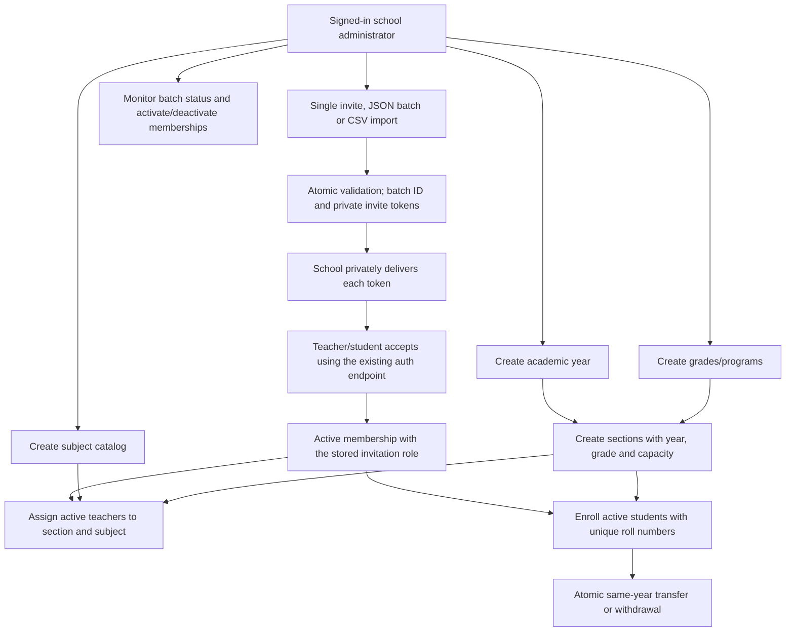

# Milestone 2: Academic Structure and School Roster

Implemented as an extension of the NestJS/PostgreSQL modular monolith. This is the
school-admin setup workflow, not the teacher/student learning portal or the full
LMS roadmap. No frontend, billing, attendance, homework or AI calls are included.

## Start and Compatibility

From `backend/`, with the existing `.env` and PostgreSQL running:

```sh
npm ci
npm run db:migrate
npm test
npm run start:dev
```

Apply migrations before starting the updated application. Existing M1 users,
schools, sessions and invitations are preserved; original invitations receive
the `school_admin` role by default. No demo student data is seeded in development.

- Canonical base: `http://127.0.0.1:3001/api/v1`.
- Swagger: `http://127.0.0.1:3001/api/docs`.
- OpenAPI JSON: `http://127.0.0.1:3001/api/docs-json`.
- All 10 original M1 operations also remain at their `/api` paths. New M2 routes
  have no unversioned aliases. Both M1 prefixes use the same handlers and rate limits.
- There are 28 new M2 operations and 38 canonical v1 operations in total.
- [M1 reference](API.md) covers login, CSRF, settings, platform onboarding and suspension.

Keep the same cookie/CSRF flow: fetch `/api/v1/auth/csrf`, send its token on login,
then use the replacement token returned by login on every POST/PATCH. Browser
requests need `credentials: 'include'`. M2 does not introduce bearer tokens.

## Workflow



New people set a password when accepting, then log in separately. Existing
accounts must log in with the invited email and accept without a password.
School-admin invite acceptance still behaves the same; the server now uses the
role stored on each invitation instead of always granting `school_admin`.

## Permissions and Response Rules

Every M2 route requires an active `school_admin` membership in an active school.
Platform privilege alone does not bypass that requirement. Teacher/student roles
can sign in and see `/auth/me`, but cannot call these administrative routes.

All path IDs are UUIDs. Record lookups and writes outside the authorized school
return `404`. List filters referencing records outside that school return an
empty result, not foreign rows. Suspended schools and wrong school roles return
`403`; missing/expired/revoked authentication returns `401`.

Creation responses are direct JSON objects (`201`), updates are direct objects
(`200`), and lists are direct pagination objects, not `data` envelopes:

```json
{ "items": [], "total": 0, "limit": 50, "offset": 0 }
```

Lists accept `limit` (1-100, default 50) and `offset` (0-100000, default 0).
Catalog/academic lists are ordered by creation time then ID; members by user ID.
`sequenceOrder` is stored for grade presentation but does not override list ordering.
Unknown query/body fields and null values are rejected where DTOs define input.
Bodyless actions take no input payload. There are no destructive delete endpoints.

M1 error shape is retained: `{statusCode, message}`, optional `error` label.
Validation failures are `400`; uniqueness, capacity and invalid lifecycle state
conflicts are `409`. Body size is still 16 KB. The normal controller limit is
120 requests/minute/IP; invite acceptance and login remain 10/minute/IP.

## Idempotent Creation

Every M2 POST requires `Idempotency-Key: <UUID>`. In Swagger, enter a newly
generated UUID for a new logical action; use the same UUID when retrying it.

```js
const key = crypto.randomUUID();
// Retain this key with the pending request until its outcome is known.
```

Records are scoped by school, actor and key. Same logical operation and normalized
payload within 24 hours return the original response/status without another domain
write or audit. Reusing the key for different input/operation returns `409`.
Single, bulk and CSV invitations normalize into the same logical invitation-batch
operation. Email normalization and CSV parsing are applied before hashing.
Keep the same payload on retry: an omitted database-default field and an explicitly
supplied default value are distinct requests.

Authorization is rechecked before a replay: suspended schools and revoked admin
memberships cannot read old results. Failed transactions do not reserve a key.
M1 POST endpoints do not acquire idempotency just because they use the v1 prefix.
PATCH operations are not idempotency-key protected and may produce another audit
event on repetition. Do not blindly retry an unknown-outcome PATCH.

The request digest is SHA-256. Responses are AES-256-GCM encrypted with a key
derived from `SESSION_SECRET` using HKDF and authenticated against school, actor
and key. This permits reliable invitation-token replay without storing plaintext
tokens. Invitation rows themselves still store only token hashes.

Replay data is logically expired at 24 hours and pruned on the school's next keyed
POST. A maintenance task should purge expired rows for dormant schools before a
pilot; physical deletion at exactly 24 hours is not implemented. Rotating
`SESSION_SECRET` invalidates sessions and makes old encrypted replays unavailable;
the API returns `409` rather than executing the action again. Resolve the original
outcome before issuing a fresh key. Replaying an old invitation response does not
unrevoke, extend or reaccept its token.

## Academic Endpoints

Prefix for every path in this table:
`/api/v1/organizations/:organizationId/academics`.

| Method | Path | Function and input |
| --- | --- | --- |
| GET | `/years` | Paginated academic years |
| POST | `/years` | Create `{name,startDate,endDate,isCurrent?}` |
| PATCH | `/years/:id` | Update one or more year fields; preserve omitted fields |
| GET | `/programs` | Paginated grades/programs |
| POST | `/programs` | Create `{name,sequenceOrder?}` |
| PATCH | `/programs/:id` | Update name/order |
| GET | `/subjects` | Paginated subject catalog |
| POST | `/subjects` | Create `{name,code}` |
| PATCH | `/subjects/:id` | Update name/code |
| GET | `/sections` | List sections; optional `academicYearId` filter |
| POST | `/sections` | Create `{academicYearId,programId,name,capacity}` |
| PATCH | `/sections/:id` | Update name/capacity; year and grade stay fixed |
| GET | `/teacher-assignments` | List section/subject/teacher links; optional `sectionId` |
| POST | `/teacher-assignments` | Create `{sectionId,subjectId,teacherUserId}` |
| PATCH | `/teacher-assignments/:id` | Replace `{teacherUserId}` |
| GET | `/enrollments` | List active and historical enrollments; optional `sectionId` |
| POST | `/enrollments` | Create `{studentUserId,sectionId,rollNumber}` |
| PATCH | `/enrollments/:id` | Update `{rollNumber}` on an active enrollment |
| PATCH | `/enrollments/:id/withdraw` | Bodyless; mark active enrollment withdrawn |
| POST | `/enrollments/:id/transfer` | `{sectionId,rollNumber}`; return the new enrollment |

### Academic Years, Grades and Subjects

Names are trimmed, nonblank and at most 120 characters. Academic-year names and
grade names are unique within the school. Dates must be real calendar dates in
`YYYY-MM-DD` format; `endDate >= startDate`. Overlapping year ranges are permitted;
only the current-year flag is exclusive. Setting `isCurrent=true` clears and audits
the previous current year in the same transaction. Zero current years is allowed.

Grade `sequenceOrder` defaults to 0 and must be an integer from 0 to 10000.
Subject codes are trimmed/uppercased, at most 32 characters, match
`^[A-Z0-9][A-Z0-9_-]*$` and are unique per school. Subject names need not be unique.

```json
{
  "name": "2026-27",
  "startDate": "2026-06-01",
  "endDate": "2027-04-30",
  "isCurrent": true
}
```

Year response example (IDs are illustrative):

```json
{
  "id": "11111111-1111-4111-8111-111111111111",
  "organizationId": "22222222-2222-4222-8222-222222222222",
  "createdAt": "2026-09-10T09:00:00.000Z",
  "name": "2026-27",
  "startDate": "2026-06-01",
  "endDate": "2027-04-30",
  "isCurrent": true
}
```

All six academic models expose `id`, `organizationId`, `createdAt` and their
domain fields. These tables do not expose an `updatedAt` field. Swagger provides
the concrete response schemas for each operation.

### Sections and Teacher Assignments

Section year and grade must belong to the authorized school; composite foreign
keys enforce this even if a future query misses application checks. Section names
are unique within school/year/grade. Capacity is an integer from 1 to 5000 and
cannot be reduced below the number of active enrollments. Section year/grade
cannot be changed through PATCH, preserving enrollment references.

Teacher assignment requires a same-school section, subject and active teacher
membership with an active global user account. One teacher is assigned to each
section/subject pair. PATCH replaces that teacher, not the section or subject.
An inactive or wrong-role local member returns `409`; no local membership returns
`404`. Co-teaching and assignment deletion are not part of M2.

### Enrollment Lifecycle

Enrollment derives `academicYearId` from the section; clients cannot supply a
different year. It requires an active student account and school membership.
`rollNumber` is a trimmed nonblank string of at most 32 characters, so leading
zeroes are preserved. Uniqueness is case-sensitive.

- At most one active enrollment per student per school/year.
- Active roll numbers are unique within a section.
- Capacity counts active enrollments, including those whose memberships have
  subsequently been deactivated. Deactivation does not silently release seats.
- Withdrawal preserves the row as `withdrawn` and releases its seat/active roll.
- Transfer must target another section in the same school and academic year.
  It marks the old row `transferred` and creates a new active row atomically.
  A full target, duplicate roll or audit failure leaves the original row active.
- Year rollover uses a new enrollment in a new year's section. Automatic promotion,
  backdated membership history and academic-year closure are not implemented.

```json
{
  "studentUserId": "33333333-3333-4333-8333-333333333333",
  "sectionId": "44444444-4444-4444-8444-444444444444",
  "rollNumber": "001"
}
```

Enrollment response adds `academicYearId`, `status=active` and the common record
fields. Transfers return the newly created enrollment, not the old transferred row.

## Roster Endpoints

Prefix: `/api/v1/organizations/:organizationId`.

| Method | Path | Function and input |
| --- | --- | --- |
| POST | `/invitations` | One `{email,role}`; returns a one-record batch |
| POST | `/invitations/bulk` | `{records:[{email,role},...]}`; 1-100 records, all or nothing |
| POST | `/invitations/import` | `{csv:"email,role\n..."}`; same atomic batch operation |
| GET | `/invitation-batches` | Paginated batch summaries, no tokens |
| GET | `/invitation-batches/:id` | All invite statuses for one batch (at most 100), no tokens |
| PATCH | `/invitations/:id/revoke` | Bodyless; revoke an unaccepted teacher/student invite |
| GET | `/members` | Paginated teacher/student memberships; optional `role` filter |
| PATCH | `/members/:id` | User UUID; `{status:"active"}` or `{status:"inactive"}` |

Only `teacher` and `student` are accepted invitation roles. No account password,
global role or arbitrary organization ID can be supplied. Existing memberships
(including inactive ones) cause `409`; use status management instead of reinviting.
Active pending invites also cause `409`. Expired pending invites are revoked and
audited when replaced; live invites must first be explicitly revoked.

```json
{
  "records": [
    { "email": "teacher@school.example", "role": "teacher" },
    { "email": "student@school.example", "role": "student" }
  ]
}
```

CSV is text inside JSON, not a file upload. This avoids a multipart subsystem for
small pilot batches. CSV parsing uses `csv-parse`, with quoted fields, BOM and blank
lines supported. Headers must be exactly `email,role` in that order. The CSV field
is limited to 12000 characters and 100 rows; the overall JSON limit is still 16 KB.
Split large school rosters into batches that meet both limits.

```json
{ "csv": "email,role\nteacher@school.example,teacher\nstudent@school.example,student" }
```

Emails are trimmed/lowercased. Duplicates in the normalized batch, malformed CSV,
invalid roles or any conflicting row reject the entire operation. Invalid input
does not create some users, send some emails or leave a partial batch.

Creation response:

```json
{
  "batchId": "55555555-5555-4555-8555-555555555555",
  "invitations": [
    {
      "id": "66666666-6666-4666-8666-666666666666",
      "email": "teacher@school.example",
      "role": "teacher",
      "token": "aaaaaaaaaaaaaaaaaaaaaaaaaaaaaaaaaaaaaaaaaaaaaaaaaaaaaaaaaaaaaaaa",
      "expiresAt": "2026-09-12T09:00:00.000Z"
    }
  ]
}
```

The sample token is not valid. Deliver real tokens privately. No email/WhatsApp
delivery is implemented. Acceptance remains `POST /api/v1/auth/invitations/accept`
with cookie/CSRF, a token and a password for a new account only.

Batch detail responses replace `token` with computed `status` (`pending`,
`accepted`, `revoked`, `expired`), `acceptedAt` and `revokedAt`. These timestamps
are nullable. Raw tokens and hashes are never present in GET responses.

Membership PATCH changes only that school's membership status. It cannot change
email, password, global account activity, platform privilege or school role.
The same user in another school is unaffected. Academic links remain as history;
future teacher/student learning APIs must recheck active membership, not assume
that an old assignment grants access. Parent and school-admin membership management
are deliberately not exposed through this API.

## Transactions and RLS

`SchoolWork.run()` uses one TypeORM transaction and its manager for authorization,
tenant context, idempotency, domain writes and audit. It calls the shared M1
school-admin check, then sets tenant context with a bound parameter:

```sql
SELECT set_config('app.current_org_id', $1, true);
```

The final `true` makes the setting transaction-local; pooled connections do not
keep the school context after commit/rollback. All new queries use that manager.
There is no interceptor setting context on one connection while queries use another.
Writes currently serialize on the school row, keeping capacity checks, current-year
changes, import retries and revocation consistent. This is a deliberate pilot-scale
limit; move to finer-grained locks only after measuring contention.

Forced RLS protects these eight new tables: `academic_years`, `programs`, `subjects`,
`sections`, `class_subject_assignments`, `enrollments`, `invitation_batches`,
`idempotency_records`. Without context, an ordinary role sees no rows and cannot
insert tenant rows. Cross-school composite foreign keys enforce related-record scope.

**Important:** original M1 `organizations`, `memberships`, `invitations`, `users`,
`sessions` and `audit_events` do not gain RLS in this migration. Their existing
application checks remain. Migrating the M1 authentication/profile/platform flows
to RLS needs its own design; this implementation does not claim universal DB isolation.

Superusers and `BYPASSRLS` roles bypass even forced RLS. The production application
refuses to start with such a database role. The development cluster's `edops`
administrator is for local convenience; the integration suite tests a separate
non-owner, non-BYPASSRLS runtime role to prove that policies actually execute.

### Runtime Role Setup

Use a separate migration owner and API login. Example for the default `public`
schema, run by a database administrator after migrations:

```sql
CREATE ROLE edops_api LOGIN NOSUPERUSER NOBYPASSRLS;
-- Set its password through your secret-provisioning process, not checked-in SQL.
GRANT USAGE ON SCHEMA public TO edops_api;
GRANT SELECT ON users, organizations, memberships, invitations, sessions,
  audit_events, academic_years, programs, subjects, sections,
  class_subject_assignments, enrollments, invitation_batches,
  idempotency_records TO edops_api;
GRANT INSERT ON users, audit_events TO edops_api;
GRANT INSERT, UPDATE, DELETE ON organizations, memberships, invitations, sessions,
  academic_years, programs, subjects, sections, class_subject_assignments,
  enrollments, invitation_batches, idempotency_records TO edops_api;
```

Point the API `DATABASE_URL` to that login. Run migrations/bootstrap with the
separate owner URL, not the runtime URL. Do not grant DDL, TRUNCATE, ownership,
superuser, BYPASSRLS or membership in the migration-owner role to the runtime user.
New migrations require reviewing explicit grants. Use verified TLS and a secrets
manager in production; never disable certificate checks to make a connection work.

### Audit Events

Academic creation/update events use `before`/`after` snapshots in the same transaction:
`academic_year.created/updated`, `program.created/updated`, `subject.created/updated`,
`section.created/updated`, `teacher_assignment.created/updated`,
`enrollment.created/updated/withdrawn/transferred`.

Provisioning records `invitations.created` with batch ID/count, `invitation.revoked`
with invitation ID/reason, and `membership.updated` with user ID and status change.
Acceptance retains `invitation.accepted`. Passwords, tokens and ciphertext are not
included in audit. A replay adds no second event. Database failures roll back the
domain rows, audit and idempotency record together.

## Verification and Deferred Decisions

`npm test` runs M1 compatibility checks and M2 real-PostgreSQL tests. It creates
isolated temporary schemas and a temporary least-privilege login, then cleans them
up. `TEST_DATABASE_URL` must end in `_test`; its administrator needs CREATE ROLE
and schema permissions. No test data is written into the development database.

Tests cover scope denial, real RLS without WHERE clauses, composite foreign keys,
partial updates, date validation, atomic imports, CSV edge cases, role escalation,
invite revocation/expiry, encrypted idempotency, retries/concurrent creates,
capacity races, transfers, suspension and transaction rollback.

The supplied architecture spec includes suggestions as well as the phased roadmap.
M2 makes these deliberate choices:

- PostgreSQL sessions stay in place; rate limits are still in-process, not stored
  in PostgreSQL. Shared Redis limit storage belongs before multi-replica deployment.
- Idempotency uses the same PostgreSQL transaction, not a Redis/database dual write.
- School-admin authorization is centralized in the existing scope check plus
  `SchoolWork`; no CASL/Casbin dependency until M3 introduces actual teacher/student
  resource policies.
- No outbox/queue is added without a consumer. Add an outbox in the same transaction
  when M4 notifications/timeline need it; do not publish externally inside a transaction.
- No MongoDB, AI service, LLM calls, object storage, billing or fee collection yet.
- No real-student pilot readiness claim: consent/guardian relationships, recovery,
  MFA, retention/deletion workflows, backups, operational monitoring and legal review
  remain prerequisites. This code does not verify the spec's legal or market claims.

Next product milestone: attendance, homework assignments, submissions and derived
scorecards, with teacher/section and student/enrollment authorization tests.
