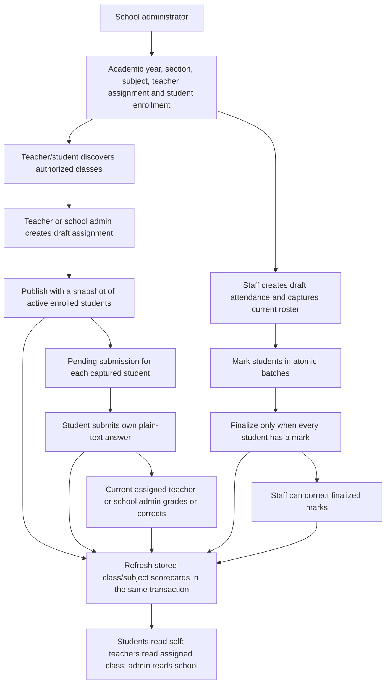
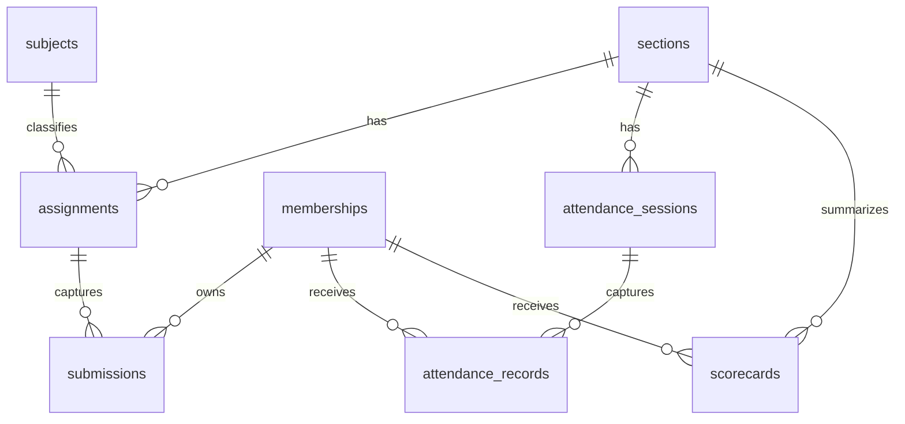

# Milestone 3: Teaching, Attendance and Scorecards

M3 extends the existing NestJS/PostgreSQL backend with the school-admin, teacher
and student teaching loop. It adds 16 v1 operations and five RLS-protected tables.
M3 brought the API to 54 canonical v1 operations; the 10 original M1 aliases remain.
There is no frontend implementation in this milestone.

The current branch also includes [M4](MILESTONE-4.md), with 12 more operations,
five additional RLS tables and a durable outbox attached to qualifying teaching
writes. Follow M4 for the expanded grants and worker startup instructions.
[M5](MILESTONE-5.md) adds Arena practice and three additional scorecard fields;
run all six migrations before starting the current API. [M6](MILESTONE-6.md)
adds optional-feature gates; core teaching and stored scorecards remain available
after subscription expiry unless the school itself is suspended.

## Run and Upgrade

From `backend/`, with PostgreSQL running and the existing `.env`:

```sh
npm ci
npm run db:migrate
npm test
npm run start:dev
```

The additive `1788998400000-Teaching` migration creates assignments, submissions,
attendance sessions/records and scorecards. It does not reset M1/M2 data or seed
student data. Run all three migrations before starting the current application.
Do not roll back this migration on a populated school: its down migration drops
the five teaching tables.

For a separate production runtime role, run migrations as the owner and grant
the API role the new tables after migration:

```sql
GRANT SELECT, INSERT, UPDATE ON assignments, submissions, attendance_sessions,
  attendance_records, scorecards TO edops_api;
```

These grants supplement [M2 runtime grants](MILESTONE-2.md#runtime-role-setup).
Use the correct schema for a non-public installation. Never give the API role
ownership, DDL, TRUNCATE, superuser or BYPASSRLS privileges. Production rejects
superuser/BYPASSRLS connections. M1 tables still rely on application isolation;
all 13 M2/M3 tables use forced RLS as a tenant-isolation backstop.

API base: `http://127.0.0.1:3001/api/v1`.
Swagger: `http://127.0.0.1:3001/api/docs`; OpenAPI: `/api/docs-json`.
Swagger/OpenAPI are disabled in production. See [M1 setup](MILESTONE-1.md)
and [M2 roster setup](MILESTONE-2.md) before creating teaching records.

## Workflow



All qualifying writes, scorecard refreshes and their audit events commit together.
No mail, notification, queue or external service runs inside these transactions.

## Permissions

| Caller | Scope |
| --- | --- |
| School administrator | Teaching records in their own active school, including whole-class attendance |
| Teacher | Only section/subject pairs currently assigned to them by M2 |
| Student | Current active enrollment, own captured published assignments/submissions, own finalized attendance and own scorecards |
| Parent | No M3 access; guardian relationships and consent workflows remain unimplemented |
| Platform administrator | No implicit school-data bypass; must have an appropriate local membership |

Every request checks the current active account, membership and organization.
Resource authorization also runs before returning an idempotent replay. Replacing
a teacher removes the former teacher's access to that section/subject, including
drafts they created and old replay responses. The replacement teacher can manage
that subject's existing work. Ownership is the current teaching assignment, not
the historical `createdBy` value.

No active school membership or foreign/unavailable resource returns `404`.
Disallowed role returns `403`; suspended school returns `403`; missing/expired
authentication returns `401`. Students cannot nominate another `studentId` when
submitting, list classmates' answers or view drafts. Student transfers/withdrawals
remove access to old-section learning resources; historical records remain
available to authorized staff. Historical student self-service is deferred.

`TeachingAccess` centralizes class, assignment and attendance policies without a
new policy-engine dependency. `SchoolWork` remains school-admin-only by default
for M2; M3 explicitly supplies allowed roles and a resource authorization callback.
Teacher/student access to M2 administrative endpoints is not widened.

## Request Rules

- Prefix all paths below with `/api/v1/organizations/:organizationId/teaching/`.
- Cookie sessions and `X-CSRF-Token` remain mandatory for writes. Fetch `/auth/csrf`,
  log in, then use the replacement token; browser calls need `credentials: 'include'`.
- Every M3 POST requires a UUID `Idempotency-Key`. Same school/actor/key/action/body
  replays for 24 hours after rechecking access; conflicting reuse returns `409`.
  Replays return the original response, which may now be older than the resource.
  Use a GET to read current state. A replay never undoes a later grade or correction.
- POST success is `201`, including publish/finalize and answer replacement. PATCH
  success is `200`. PATCH has no replay protection and repeated writes may add audit.
- Lists return `{items,total,limit,offset}`, with `limit=50` (1-100), `offset=0`
  (0-100000). Unknown DTO fields and null values are rejected unless documented.
- Empty actions accept `{}` or no body, not arbitrary extra fields. JSON body
  limit remains 16 KB; attendance batches must fit both the record and byte limits.
- Errors retain `{statusCode,message}` with an optional `error` label. Normal
  controller rate limit remains 120/minute/IP, stored in-process.

## Endpoints

| Operation | Function and result |
| --- | --- |
| `GET classes` | `TeachingService.classes`: paginated visible section/subject links with class, subject and teacher IDs; teachers see their assignments, students their enrolled classes |
| `GET roster` | `TeachingService.roster`: staff-only active roster; query `sectionId`, optional `subjectId` (required for teachers); returns studentId, rollNumber, email |
| `GET assignments` | `AssignmentsService.list`: requires sectionId and subjectId; staff see drafts/published, students only their eligible published work |
| `POST assignments` | `AssignmentsService.create`: creates a draft from sectionId, subjectId, title, description?, dueAt, maxScore |
| `GET assignments/:id` | `AssignmentsService.get`: authorized assignment details |
| `PATCH assignments/:id` | `AssignmentsService.update`: nonempty partial title/description/dueAt/maxScore update; draft only |
| `POST assignments/:id/publish` | `AssignmentsService.publish`: captures active students as pending submissions and publishes; empty body |
| `GET assignments/:id/submissions` | `AssignmentsService.submissions`: staff see the assignment snapshot, student sees only self; includes pending rows |
| `POST assignments/:id/submissions` | `AssignmentsService.submit`: student creates/replaces own ungraded plain-text answer with `{content}` |
| `PATCH submissions/:id/grade` | `AssignmentsService.grade`: staff grades or corrects `{score,feedback?}` and refreshes scorecards |
| `GET attendance-sessions` | `AttendanceService.list`: query sectionId and optional subjectId; students see only their finalized sessions |
| `POST attendance-sessions` | `AttendanceService.create`: creates draft from sectionId, subjectId?, date, period and captures the current active roster |
| `GET attendance-sessions/:id/records` | `AttendanceService.records`: paginated captured marks; student sees only self after finalization |
| `PATCH attendance-sessions/:id/records` | `AttendanceService.mark`: atomic `{records:[{studentId,status}]}` batch; returns the session, not the marks; read marks using GET |
| `POST attendance-sessions/:id/finalize` | `AttendanceService.finalize`: requires every student marked; empty body; refreshes scorecards |
| `GET scorecards` | `ScorecardsService.list`: query sectionId and optional subjectId; reads persisted rows, never performs a live aggregation |

For attendance and scorecards, omitting subjectId means **whole-class attendance
only**, not a wildcard for all subjects. Whole-class records are separate from
subject attendance to avoid double counting. Teachers must specify an assigned
subject; whole-class administration is school-admin-only because M2 has no
homeroom-teacher assignment. Students may read their own whole-class records.

## Assignments and Submissions

```json
{
  "sectionId": "11111111-1111-4111-8111-111111111111",
  "subjectId": "22222222-2222-4222-8222-222222222222",
  "title": "Linear equations",
  "description": "Solve the worksheet and explain your steps.",
  "dueAt": "2026-10-01T12:00:00+05:30",
  "maxScore": 20
}
```

IDs and timestamps in examples are illustrative; use real authorized IDs and a
future deadline. Title is trimmed/nonblank, at most 200 characters; description
defaults to empty and is at most 8000. Due dates require an explicit timezone
and must be future on creation or when updated. Publishing also checks that the
deadline has not passed. Maximum score is 0.01-10000 with up to two decimals.

Drafts can be edited; published assignments cannot be edited, unpublished or
deleted through M3. This prevents changed denominators/deadlines after students
start. Publication requires at least one active enrolled student account and
captures exactly those students. Later enrollment does not retroactively assign
old homework; withdrawal does not delete old pending/submitted work. Extending
deadlines, assigning late joiners and exempting students need explicit later APIs.

```json
{ "content": "My solution and explanation..." }
```

Answers are trimmed nonblank plain text up to 8000 characters. M3 stores `content`,
not a `contentRef`: no files are accepted, URLs are not fetched, and no attachment
storage is claimed. Render content/feedback as text, not trusted HTML.
Submission identity and timestamps come from the session/server. An ungraded
answer can be replaced using a new key, including after the deadline; its latest
submission time determines `submitted` versus `late`. Previous answer versions
are not retained. Graded answers cannot be replaced.

```json
{ "score": 16, "feedback": "Recheck the sign in your second step." }
```

Grading requires a submitted answer and a score between zero and maxScore, with
up to two decimals. Corrections replace the grade and record its before/after
score. Feedback is limited to 4000 characters; omission preserves existing feedback,
and an empty string clears it. `gradedBy`/`gradedAt` are server controlled.
Status becomes `graded`; lateness remains derivable from submittedAt and dueAt.

## Attendance Lifecycle

```json
{
  "sectionId": "11111111-1111-4111-8111-111111111111",
  "subjectId": "22222222-2222-4222-8222-222222222222",
  "date": "2026-09-10",
  "period": 1
}
```

Period is an integer 1-20, not a timetable integration. Date must be a real
YYYY-MM-DD within the section's academic year and no later than today in the
organization timezone. The session is unique per school/section/subject/date/period,
including a unique whole-class session when subject is omitted.

Creation captures the **current** active enrolled student accounts and requires a
nonempty roster. All marks start as null (unmarked), not absent. Backdated creation
does not reconstruct the historical roster: operators must account for that
limitation before using backdated attendance. Existing snapshots stay unchanged
when students later join, transfer, withdraw or deactivate.

```json
{
  "records": [
    { "studentId": "33333333-3333-4333-8333-333333333333", "status": "present" },
    { "studentId": "44444444-4444-4444-8444-444444444444", "status": "excused" }
  ]
}
```

Mark 1-100 unique snapshot students at a time; multiple batches support larger
classes. Allowed statuses are present, absent, late, excused. A duplicate, invalid
mark or student outside the snapshot rejects the whole batch. Omitted students
keep their previous mark. Finalization rejects any remaining null marks (`409`).

Drafts do not affect scorecards and are hidden from students. Finalization makes
each student's own record visible and refreshes scorecards. Staff may correct
finalized marks; corrections refresh scores and are audited atomically. There
is no delete, reopen, bulk roster replacement or silent default-absent operation.

## Scorecard Definitions

Scorecards are persisted per school/student/section/subject for `term=academic_year`.
The section determines the academic year. Configurable terms, weighted grading,
promotion rules and letter grades are not implemented. M5 adds Arena practice
metrics; see its guide for the exact scoring formula.

| Field | Definition |
| --- | --- |
| assignmentCount | Published assignments whose captured roster includes the student |
| submittedCount | Those assignments with a submitted answer, including late or graded work |
| gradedCount | Those assignments with a grade |
| avgScore | Mean of each graded assignment's `(score / maxScore) * 100`; equal assignment weight, not pooled raw points |
| completionPct | `100 * submittedCount / assignmentCount` |
| attendanceCount | Finalized attendance records excluding excused |
| attendedCount | Present plus late within those finalized records |
| attendancePct | `100 * attendedCount / attendanceCount` |
| arenaAttemptCount | All objective Arena attempts in the class/subject |
| arenaQuestionCount | Distinct attempted Arena questions, including archived ones |
| arenaScore | Mean best-attempt percentage per attempted question; null before practice |
| generatedAt | Last qualifying transactional refresh timestamp |

Missing/zero denominators produce null, not a misleading zero. Ungraded work does
not count as a zero grade. Pending work does count in the completion denominator.
A class/subject without any published assignments, finalized attendance or Arena attempts has no
scorecard row yet. Whole-class scorecards contain attendance only, with zero
assignment counts and null assignment metrics. Their Arena counts are zero and Arena score is null.

Publishing, submitting, grading/regrading, attendance finalization and finalized
mark correction refresh affected class/subject rows before commit. Independent
SQL aggregates prevent attendance/submission join multiplication. GET reads stored
rows and does not change generatedAt. No scheduled job or Redis queue is necessary
for this pilot-scale implementation. Write latency grows with class history;
move refreshes to a transactional outbox worker after measuring that bottleneck.
Out-of-band database edits are unsupported and do not automatically refresh reports.

## Transactions and Schema



All new rows carry organization_id and composite same-school foreign keys to
their related tenant records. All five tables have forced RLS using transaction-local
`app.current_org_id`. RLS enforces tenant scope, not teacher/student row ownership;
the explicit application policies are still required. PostgreSQL 15+ is required
for `UNIQUE NULLS NOT DISTINCT` on whole-class attendance and scorecard keys.

`SchoolWork` authorizes the school, takes its write lock, sets tenant context,
rechecks resource access, handles encrypted replay and runs domain work through
the same transaction manager. The existing per-school write serialization also
coordinates with M2 enrollment/teacher changes. Narrow those locks only when
measured contention justifies the added concurrency complexity.

M3 audit actions: `assignment.created`, `assignment.updated`, `assignment.published`,
`submission.submitted`, `submission.graded`, `attendance.created`, `attendance.marked`,
`attendance.finalized`. Events capture IDs/counts, changed-field names, grade
before/after or attendance mark before/after as appropriate. Answer text and
free-text feedback are not copied into audit. Failed audit/scorecard/replay writes
roll back the domain write; a successful replay adds no second audit event.

## Verification and Remaining Work

```sh
npm run typecheck
npm test
```

Tests use isolated temporary schemas in `TEST_DATABASE_URL` (name must end in
`_test`) and a non-owner, non-BYPASSRLS runtime login. The test administrator
needs permission to create/drop schemas and roles. Tests cover M1/M2 compatibility,
M3 role/tenant/ownership checks, Swagger contracts, publication snapshots, grade
corrections, late work, atomic attendance, correct denominators, real RLS,
idempotent concurrency, access revocation before replay and transaction rollback.

Deferred: frontend screens; binary submissions/object storage; flexible terms and
grading weights; historical student access; answer version history; deadline
extensions and snapshot enrollment amendments; timetable integration; parent
access; subjective/LLM grading; billing. Arena is implemented in M5, and
notification/outbox workers and recorded classes in M4.
The scope remains backend M3, not a full school ERP.

Before a real-student pilot: administrator MFA/recovery, secure invite delivery,
first-admin invite recovery, consent/guardian and retention/deletion workflows,
monitoring, tested restores, operational review and legal review are still required.
M3 does not establish production readiness or verify the architecture spec's
legal/market claims. Shared rate limits are still required before multiple replicas.
