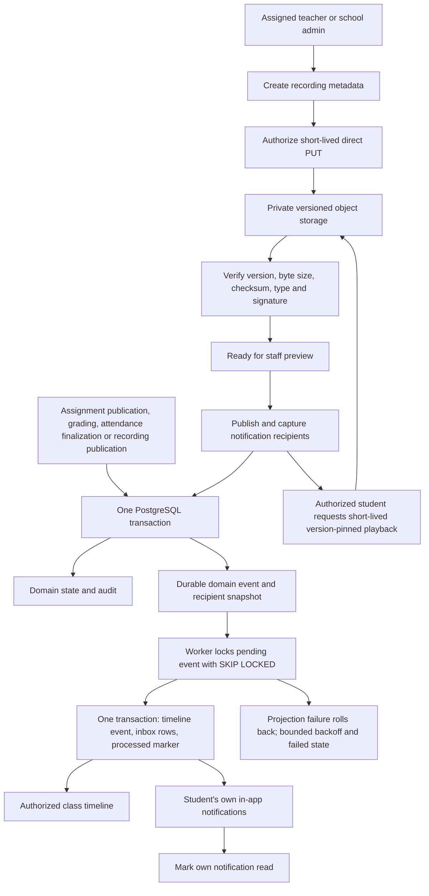

# Milestone 4: Timeline, Notifications and Recorded Classes

M4 adds a class timeline, a personal in-app notification inbox, a durable
PostgreSQL outbox worker and private S3-compatible recording workflows. It extends
the M1-M3 backend, not the frontend. Twelve new operations bring the canonical
v1 API to 66 operations at M4; the original ten M1 compatibility aliases remain.
The current branch also includes [M5 Arena](MILESTONE-5.md), for 76 canonical
operations and 20 RLS tables at M5. [M6](MILESTONE-6.md) brings the current totals
to 90 operations and 23 RLS tables; apply all six migrations. Recording and
communication APIs now also require their effective subscription feature flags.

## Start and Upgrade

From `backend/`, with the existing environment and PostgreSQL running:

```sh
npm ci
npm run db:migrate
npm test
npm run start:dev
```

In a separate terminal, after compiling:

```sh
npm run worker
```

The API and worker are separate processes sharing PostgreSQL. Restart the worker
after source changes and a rebuild; it runs compiled code, not a source watcher.
For one bounded sweep or operator retry of a school's failed events:

```sh
npm run worker -- --once
npm run worker -- --retry-failed ORGANIZATION_UUID
```

Replace ORGANIZATION_UUID with the actual school UUID. Retry is a trusted operator
CLI, not a public endpoint or permission granted to school users. Inspect the
failure and resolve its cause before retrying. A sweep handles at most 50 events
per school and discovers schools in pages of 100. Continuous mode repeats after
one second; SIGINT/SIGTERM finish current work and close the database connection.
One-shot mode exits nonzero if that sweep encounters a projection failure.

The additive fourth migration creates `recorded_sessions`, `domain_events`,
`event_recipients`, `timeline_events`, `notifications`. All five use forced RLS and
same-school foreign keys. There are now 18 RLS-protected M2-M4 tables. Original M1
tables still use application isolation. No historical M3 events are backfilled;
only qualifying writes after this migration enter the outbox.

Swagger: `http://127.0.0.1:3001/api/docs`; OpenAPI: `/api/docs-json`, current version 0.6.0.
Both are disabled in production. See [M1](MILESTONE-1.md), [M2](MILESTONE-2.md) and
[M3](MILESTONE-3.md) for onboarding and teaching prerequisites.

## Product Flow



## Outbox and Delivery

Four event types are emitted by existing domain transactions:

| Event | Snapshot recipients |
| --- | --- |
| assignment.published | Active student accounts/memberships in the assignment's publication snapshot |
| submission.graded | That submission's student, if the account/membership remains active |
| attendance.finalized | Active student accounts/memberships in the attendance snapshot |
| recording.published | Active students currently enrolled in the recording's section |

Each grade correction emits another event; a retried grade PATCH also represents
another write, as in M3. Attendance corrections do not currently emit a second
notification. Assignment publication/recording publication/finalization POST
replays add no duplicate event. Unpublished records do not enter the feed.

Events contain type, resource ID, section/subject, actor and timestamp. They do
not copy answers, grades, feedback, signed URLs or video bytes. Fetch the referenced
resource through its authorized API to render its current details. Recipients are
stored separately, with composite membership/event foreign keys; they cannot be
supplied arbitrarily by a browser.

The worker uses the same non-BYPASSRLS tenant context as the API, processes active
schools before claiming events. Suspension stops subsequent claims; an already
running projection may finish, but API reads still deny suspended schools. Multiple workers can claim
different events via `FOR UPDATE SKIP LOCKED`. Timeline/inbox uniqueness constraints
and one transaction with the processed marker prevent duplicate projection rows.
A crash rolls back unfinished work, allowing it to be claimed again.

Projection failures roll back to a savepoint, then persist a generic error code,
attempt count and a retry delay of 2, 4, 8, 16 or 32 seconds. After five failed
attempts, failed_at stops automatic retries. One failed event does not block later
events. Feed ordering is occurredAt then UUID, newest first; delivery is eventual,
not a guarantee of strict cross-event ordering. Monitor pending age, failed count
and worker process health externally; `/health` checks database connectivity only.

No Redis/BullMQ is required for these database-only projections: PostgreSQL is the
durable queue. A shared Redis throttler remains necessary before multiple API
replicas. External email/WhatsApp delivery would require separate delivery state,
provider idempotency and retries; it must not be inserted into this database
transaction as though it were atomic with PostgreSQL.

## Access Rules

- Active school, membership and account checks remain mandatory. Platform privilege
  does not bypass a school membership. Parents still have no learning access.
- Teachers need the current section/subject assignment. Reassignment removes access
  to earlier events and recordings in that class, including old idempotent replays.
- Students need a current active enrollment. Timeline and inbox additionally require
  the event's recipient snapshot. A classmate cannot see another student's grading
  event, notification ID or read status.
- Recording playback is different from event delivery: all currently enrolled
  students may watch published recordings, including those published before they
  joined. Old notifications are not retroactively sent to late joiners.
- Transfers/withdrawals hide old-section inbox items and deny old-section timeline
  and recording access. Notification total/unreadCount count only visible items.
- Archiving a recording hides its timeline/inbox event and student metadata, and
  prevents new playback authorizations. Old records and objects are retained.
- Worker fan-out rechecks account/membership activity. Students inactive at delivery
  may receive no inbox row, even if reactivated later; no backfill is implemented.

## API Reference

Prefix every operation with `/api/v1/organizations/:organizationId/`.
Cookie sessions, CSRF, unknown-field rejection and the 16 KB JSON limit remain.
Pagination uses limit 1-100 (default 50) and offset 0-100000 (default 0).
Missing/foreign resources return 404; wrong roles or suspension return 403;
authentication failure returns 401; invalid lifecycle state returns 409.

| Operation | Function and behavior |
| --- | --- |
| `GET timeline` | FeedService.timeline: requires sectionId, optional subjectId; paginated events visible to caller, newest first |
| `GET notifications` | FeedService.inbox: own inbox, filter=all or unread; returns items,total,unreadCount,limit,offset |
| `PATCH notifications/:id/read` | FeedService.read: empty body, marks only an owned visible notification; repeats preserve readAt without a second audit |
| `GET recordings` | RecordingsService.list: requires sectionId and subjectId; staff see all states, students only published |
| `POST recordings` | RecordingsService.create: create metadata and server-generated object key; returns uploading state |
| `GET recordings/:id` | RecordingsService.get: metadata only; no object key, version, checksum or signed URL |
| `PATCH recordings/:id` | RecordingsService.update: edit title/recordedAt/durationSeconds while uploading or ready |
| `POST recordings/:id/upload-url` | RecordingsService.upload: empty body; fresh upload authorization, 200 response, no replay cache |
| `POST recordings/:id/complete` | RecordingsService.complete: verify uploaded versionId, then change uploading to ready |
| `POST recordings/:id/publish` | RecordingsService.publish: empty body; ready to published, with outbox/audit in one transaction |
| `PATCH recordings/:id/archive` | RecordingsService.archive: empty body; terminal state, repeat-safe, does not delete stored object |
| `GET recordings/:id/playback` | RecordingsService.playback: fresh short-lived signed GET for the verified version; staff preview ready, students require published |

For timeline, omitted subjectId selects whole-class events only, not every subject.
Teachers cannot read whole-class attendance events because M2 has no homeroom
teacher assignment. School admins and enrolled students can access that scope.

POST create/complete/publish require a UUID Idempotency-Key and return 201; replay
is encrypted, retained for 24 hours and rechecks current resource permissions.
The stored response can be older than current state; a replay never re-publishes
an archived recording. Upload-url POST returns 200 and deliberately has no replay:
signed capabilities must be freshly authorized, not replayed for 24 hours.
All writes require X-CSRF-Token; playback GET still requires the session cookie.

## Recording Upload and Playback

Create metadata using real class IDs and the actual file's checksum:

```json
{
  "sectionId": "11111111-1111-4111-8111-111111111111",
  "subjectId": "22222222-2222-4222-8222-222222222222",
  "title": "Quadratic equations",
  "recordedAt": "2026-09-10T09:00:00Z",
  "durationSeconds": 1800,
  "contentType": "video/mp4",
  "sizeBytes": 10485760,
  "checksumSha256": "AAAAAAAAAAAAAAAAAAAAAAAAAAAAAAAAAAAAAAAAAAA="
}
```

The checksum above is illustrative, not a valid checksum for a supplied file.
Supported containers are MP4/WebM. Maximum size is 512 MiB, duration 1-28800 seconds,
title 1-200 trimmed characters, recordedAt an explicit-zone timestamp not in the
future. Duration is declared by the uploader, not measured. The server generates
`organizationId/recordings/recordingId.extension`; clients cannot choose an object
key, storage host or public video URL.

1. Create metadata and retain the recording ID.
2. Request upload-url with `{}`. PUT the exact file bytes directly to the returned
   URL with the returned Content-Type, x-amz-checksum-sha256 and If-None-Match headers.
   Content-Length is signed too; browsers set it automatically from the file body.
3. Capture storage's `x-amz-version-id` response header. Upload URLs expire after
   300 seconds and are conditional on the key not already existing. A network retry
   can therefore return 412 after an earlier success. Recover that object's version
   through an operator if its success response was lost; there is no public version
   lookup endpoint or overwrite-in-place recovery.
4. Complete with `{versionId}`. The API checks that exact version's size, MIME type,
   SHA-256 and container signature through HEAD and a bounded 32-byte range GET.
   Wrong/missing metadata returns 400; storage failure returns 503. Failed verification
   leaves the metadata uploading. Verification holds the school transaction lock
   during bounded storage requests; measure this cost before increasing upload traffic.
5. Staff can preview ready recordings, then publish. Publishing creates the durable
   notification event but does not wait for worker delivery.
6. Authorized playback returns a 120-second signed GET pinned to the verified version.
   Native storage range requests support seeking; no API video proxy is used.

```json
{ "versionId": "version-returned-by-your-storage-provider" }
```

These URLs are bearer capabilities. Do not log, persist, email or share them.
Revocation/archive prevents issuing new URLs, but previously issued URLs remain
usable until expiry. No DRM or prevention of authorized downloads is claimed.
Changing storage credentials/bucket configuration needs an operator migration plan;
existing recording rows refer to keys/versions in the configured bucket.

Metadata creation works without storage configured, but upload/verification/playback
fail closed with 503. No fake public URL or local-file fallback is provided.
Changing bytes after metadata creation requires a new recording; archive an abandoned
one. Published metadata is immutable and archive is terminal. There is no hard-delete
API, multipart/resumable upload, transcoding, transcript generation, antivirus scan
or automatic object cleanup. Signature checking is not full media validation or
a malware guarantee; do not expose uploads to untrusted public users.

## Storage Configuration

Configure a private, versioned S3 bucket (or compatible service implementing
versioned HEAD/GET, SHA-256 checksums and conditional PUT):

```text
S3_BUCKET=your-private-recording-bucket
S3_REGION=ap-south-1
```

Optional S3_ENDPOINT is an exact HTTPS origin. Loopback HTTP is allowed only
outside production. Explicit S3_ACCESS_KEY_ID/S3_SECRET_ACCESS_KEY must be supplied
together; otherwise the official SDK uses its default AWS credential chain.
Prefer an IAM workload role and never check credentials into source control.
The SDK client and presigner follow the [official AWS SDK v3 example](https://aws.amazon.com/blogs/developer/generate-presigned-url-modular-aws-sdk-javascript/).

Bucket provisioning is an operator action, not something the API does at startup:

- Enable versioning; completion rejects missing or `null` object versions.
- Block public access, deny non-TLS production traffic and use encryption at rest.
- Grant the runtime PutObject on recording keys and GetObjectVersion for verification/
  playback. Do not grant public ACL, bucket-management or delete permissions.
- Configure CORS for your exact web origin and methods PUT, GET, HEAD; allow
  Content-Type, x-amz-checksum-sha256, If-None-Match and required SDK/browser headers;
  expose x-amz-version-id and ETag. Do not copy an unrestricted origin policy.
- Define retention for abandoned uploads and archived versions through an operator
  process tied to database state. Blind age-based deletion can break published videos.
- Check provider support for versioned checksums and conditional writes, not just
  an S3-compatible label. See [AWS conditional writes](https://docs.aws.amazon.com/AmazonS3/latest/userguide/conditional-writes-enforce.html).

## Database Runtime Grants

Supplement the earlier milestone grants after migrating, adapting the schema/role:

```sql
GRANT SELECT, INSERT, UPDATE ON recorded_sessions TO edops_api;
GRANT SELECT, INSERT ON domain_events, event_recipients TO edops_api;
GRANT SELECT ON timeline_events TO edops_api;
GRANT SELECT, UPDATE ON notifications TO edops_api;

CREATE ROLE edops_worker LOGIN NOSUPERUSER NOBYPASSRLS;
-- Set its password through the secret-provisioning process.
GRANT USAGE ON SCHEMA public TO edops_worker;
GRANT SELECT ON organizations, memberships, users, domain_events,
  event_recipients, timeline_events, notifications TO edops_worker;
GRANT UPDATE ON domain_events TO edops_worker;
GRANT INSERT ON timeline_events, notifications TO edops_worker;
```

Run the worker with its own DATABASE_URL, using the same schema/config and no DDL,
TRUNCATE, ownership or BYPASSRLS grants. The worker's organization directory read is
explicitly privileged for tenant dispatch; all event/projection queries then use
transaction-local tenant context. Do not expose worker credentials to browsers.

## Verification and Limits

`npm test` includes M1-M3 regressions and dedicated M4 tests using real PostgreSQL
with a non-owner runtime role. They cover event atomicity, concurrent workers,
retry exhaustion/recovery, private grading events, own-inbox read state, tenant
isolation, snapshots, recording lifecycle, signed request parameters, checksum and
version verification, archive/revocation and fail-closed storage configuration.
The worker is also tested with only its documented runtime grants.

Storage tests use a loopback HTTP protocol fixture with the real AWS SDK. It is
not a production S3 authorization emulator: it does not prove IAM, bucket CORS,
real signature enforcement, browser playback codecs or your provider's deployment.
Complete a real private-bucket upload/playback smoke test before a school pilot.
Docker not running and absent cloud credentials must not be mistaken for that check
having passed. No real student data is sent to a storage provider during these tests.

Remaining M4-adjacent integrations: outbound email/WhatsApp/mobile push, video
transcoding/transcripts, resumable large uploads, frontend timeline/inbox/player,
privacy retention/deletion operations and production monitoring. M1-M3 MFA/recovery,
consent/guardian, backup/restore and legal-review prerequisites still apply. This
milestone does not claim production or real-student pilot readiness.
