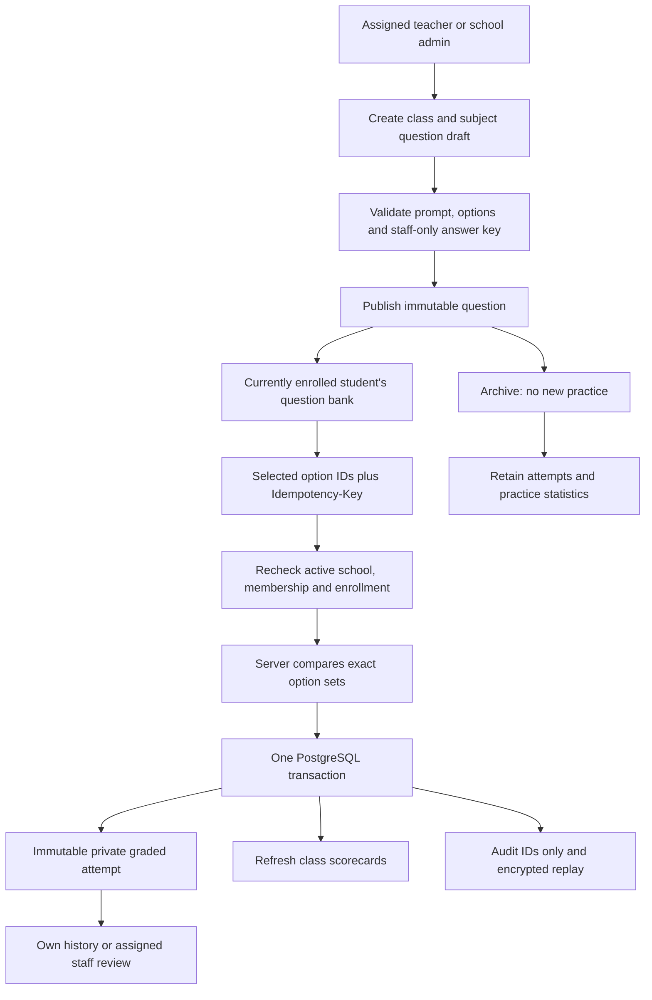

# Milestone 5: Objective Arena Practice

M5 adds a class-scoped question bank and deterministic objective grading to the
B2B school backend. Ten new operations bring the canonical `/api/v1` API to 76,
OpenAPI version 0.5.0. No new dependencies, LLM calls, Python service or database
engine are required. This is practice, not a secure examination system.
The current branch also includes [M6](MILESTONE-6.md): 90 canonical operations,
OpenAPI 0.6.0 and an Arena entitlement check on all these routes before replay.
Apply all six migrations; existing stored Arena scorecard aggregates remain in the
core teaching scorecard API even when new Arena access is disabled.

## Setup and Upgrade

From `backend/`, with the existing PostgreSQL environment configured:

```sh
npm ci
npm run db:migrate
npm test
npm run start:dev
```

The additive fifth migration creates `arena_questions` and `arena_attempts`,
both with forced RLS and same-organization foreign keys. It adds three scorecard
columns with defaults of zero attempts/questions and null score for existing rows.
There are now 20 RLS-protected M2-M5 tables; M1 tables still use application-level
isolation. Deploy the migration before starting the updated API, including for M3
scorecard writes which now reference the Arena tables. No historical grades change.

For a separately provisioned API database role, supplement the earlier grants:

```sql
GRANT SELECT, INSERT, UPDATE ON arena_questions TO edops_api;
GRANT SELECT, INSERT ON arena_attempts TO edops_api;
-- Existing SELECT, INSERT, UPDATE grants on scorecards remain necessary.
```

Do not give the API DELETE grants on these tables or UPDATE grants on attempts.
Use the existing non-owner, non-BYPASSRLS runtime role. Database administrators
remain privileged; RLS is a tenant backstop, not student-versus-teacher authorization.
The M4 worker needs no Arena grants and is not involved in auto-grading.

## Product Flow



The bank is scoped to a school, section and subject, using the existing teaching
assignment policy. There is no global/shared bank, cross-school sharing or separate
question-to-class assignment layer. Reuse in another section currently requires
creating a new draft. Add a reusable school-wide library only when real school
workflows justify its publishing and ownership rules.

## Question Contract

```json
{
  "sectionId": "11111111-1111-4111-8111-111111111111",
  "subjectId": "22222222-2222-4222-8222-222222222222",
  "topic": "Addition",
  "difficulty": "easy",
  "questionType": "single_choice",
  "content": {
    "prompt": "What is 2 + 2?",
    "options": [{ "id": "a", "text": "4" }, { "id": "b", "text": "5" }]
  },
  "answerKey": ["a"],
  "tags": ["arithmetic"],
  "maxScore": 10
}
```

Use actual IDs from M2. Required fields:

| Field | Validation |
| --- | --- |
| sectionId, subjectId | Same-school UUIDs; teacher must currently be assigned to both |
| topic | Trimmed nonempty text, maximum 100 characters |
| difficulty | easy, medium or hard |
| questionType | single_choice or multiple_choice |
| content.prompt | Trimmed nonempty plain text, maximum 4000 characters |
| content.options | 2-8 objects with unique IDs and nonempty text |
| option.id | 1-16 lowercase letters, digits, underscores or hyphens |
| option.text | Trimmed nonempty text, maximum 500 characters |
| answerKey | 1-8 unique existing option IDs; exactly one for single_choice |
| tags | Required array, may be empty; maximum 10 unique strings of 1-32 characters |
| maxScore | Integer 1-100 |

Unknown fields, including nested fields, are rejected. Inputs are not trusted HTML;
frontends must render prompt/options as text. No arbitrary URL fetching, uploads,
code execution, regex-based grading or student identity in the attempt body.

Draft PATCH accepts a nonempty subset of topic, difficulty, questionType, content,
answerKey, tags and maxScore. Omitted fields are preserved; explicit null is invalid.
Content replaces the whole content object. The resulting content and key must agree,
so changing option IDs may require changing the key in the same request.

Publishing freezes the question and key. Archive is terminal and repeat-safe.
To correct a published question, archive it and create a replacement draft; existing
attempts retain their original scores. This milestone has no retrospective regrading.

## API Reference

Prefix the following paths with `/api/v1/organizations/:organizationId/arena/`.
Cookie sessions and CSRF apply unchanged. Create, publish and attempt POSTs require
a UUID Idempotency-Key and return 201. GET/PATCH return 200. Pagination is limit 1-100
(default 50), offset 0-100000 (default 0). No legacy `/api` aliases are added.

| Operation | Function and behavior |
| --- | --- |
| `POST questions` | ArenaService.create: staff create a validated draft, audit and encrypted replay atomically |
| `GET questions` | ArenaService.list: required sectionId/subjectId; optional exact topic/tag/difficulty/status filters; newest first |
| `GET questions/:id` | ArenaService.get: safe question content and metadata, never answerKey |
| `GET questions/:id/answer-key` | ArenaService.get with staff check: only assigned teacher or school admin receives correct IDs |
| `PATCH questions/:id` | ArenaService.update: merge and validate a draft edit; scope is immutable |
| `POST questions/:id/publish` | ArenaService.transition: empty body, draft to published; no duplicate write on replay |
| `PATCH questions/:id/archive` | ArenaService.transition: empty body, draft/published to archived; no deletion |
| `POST questions/:id/attempts` | ArenaService.submit: enrolled student answer, exact grading, persisted attempt and scorecard refresh |
| `GET questions/:id/attempts` | ArenaService.attempts: own student history or current assigned staff class history, newest first |
| `GET attempts/:id` | ArenaService.attempt: own result or current assigned staff access; peer/foreign records return 404 |

All ordinary question responses, even staff create/list/update responses, exclude
the answer key. Editors fetch it through the separate staff-only endpoint. It is
not exposed to students after an attempt either. Attempts return submittedAnswer,
isCorrect, score, maxScore, IDs and createdAt; they never include the full key.

Errors: invalid data/key/query 400, unauthenticated 401, CSRF/wrong role/suspension
403, missing/foreign/inaccessible record 404, invalid lifecycle or conflicting
idempotency reuse 409, oversized JSON 413, rate limit 429, unexpected failure 500.
Existing 16 KB JSON body and per-route rate limits remain.

## Grading and Retries

```json
{ "selectedOptionIds": ["a"] }
```

The server derives studentId, questionId, timestamp and score. Single-choice accepts
exactly one valid option ID. Multiple-choice requires at least one unique valid ID
and compares the selected set with the entire correct set, independent of order.
Exact match earns maxScore; missing or extra options earn zero. No partial credit,
negative marking, subjective grading or AI feedback is implied.

Practice retries with a new key create new immutable attempts. Reusing a key and the
same selection set returns the original result for 24 hours; reordering options does
not create a new logical attempt. Different selections under that key return 409.
Concurrent requests are serialized through the existing school write transaction.
Authorization runs before replay: revoked enrollment, reassigned teachers and school
suspension take effect immediately. Archived question attempts cannot be replayed
through the submit route; use the existing attempt/history GET to confirm an outcome.

Audits contain IDs and edited field names, not question text, keys or student answers.
Successful write responses are encrypted in the existing replay table. A failure in
grading persistence, scorecard refresh, audit or replay insertion rolls back the entire
write. Normal read responses never issue public content URLs or student lists.

## Scorecard Semantics

The existing `GET /api/v1/organizations/:organizationId/teaching/scorecards` now adds:

| Field | Meaning |
| --- | --- |
| arenaAttemptCount | All persisted attempts in the section/subject |
| arenaQuestionCount | Distinct questions attempted by that student |
| arenaScore | Mean of the best percentage for each attempted question; null before practice |

Examples: best results of 100% and 0% give 50%. Repeating the already-correct question
does not increase that average. Solving the second correctly raises it to 100%.
Unattempted questions are excluded; archived questions with attempts stay included.
This is a practice mastery indicator, not completion percentage or examination grade.
Unlimited attempts plus immediate correctness allow students to infer answers; do not
use this workflow for high-stakes tests or a competitive leaderboard.

Arena metrics are refreshed transactionally on attempts, alongside independent M3
assignment and attendance aggregates. M3 writes also preserve/recompute Arena data.
Counts cannot be multiplied by joining attempts directly onto submissions/attendance.
Section IDs already identify academic years. Whole-class null-subject scorecards
have no Arena activity. Reads return stored aggregates without recomputation.

## Access and Limits

- School admins manage their own school only. Platform admins need school membership.
- Assigned teachers manage questions and review attempts in current section/subject
  assignments, even when the original author was another teacher.
- Students see published questions for current enrollments, including late joiners.
  They can only submit as themselves and read their own attempt histories.
- Archive hides question content and new practice. An enrolled student with past
  attempts can still read those results; unattempted archived questions remain hidden.
- Withdrawal/transfer removes access to old-class questions, results and scorecards.
- Parents have no Arena access. No public/global bank or cross-tenant reporting.

Known scale ceiling: existing per-school write serialization and synchronous class
scorecard refresh target pilot traffic. Profile write latency before introducing
per-resource locks or queued scorecard aggregation. M4 feeds do not receive Arena
events; the attempt response already delivers immediate feedback.

Deferred: shared school/global libraries, bulk question imports, timed tests, attempt
limits, leaderboards, free-text/numeric/coding questions, explanations, LLM grading,
frontend Arena screens and privacy deletion workflows. No student data is sent to an
external AI provider. M6 billing and M7 consent-gated AI remain separate milestones.

## Verification

`npm test` builds and runs M1-M5 integration tests against isolated local PostgreSQL
test schemas. M5 checks incremental M4-to-M5 migration, nested validation, teacher and
student permissions, hidden answer keys, single/multiple choice correctness, concurrent
replays, scorecard math and M3 coexistence, rollback, archive/history, revocation,
cross-school FKs and actual RLS using a non-owner, non-BYPASSRLS database role.
Use TEST_DATABASE_URL ending in `_test`; fixtures do not use production school data.
This does not replace a school pilot, load testing or privacy/security rollout review.
