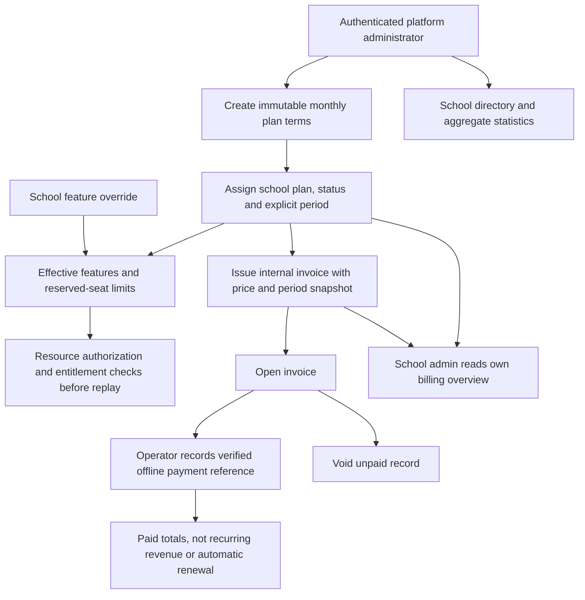

# Milestone 6: Platform Billing, Entitlements and Statistics

M6 adds 14 backend operations, bringing the canonical v1 total to 90 and OpenAPI
to 0.6.0. The product is billed to schools, never individual teachers/students.
This is an internal manual billing ledger, not payment processing, automatic
collection or a statutory tax-invoice implementation. No new dependencies.

## Start and Upgrade

Run from `backend/` with the existing PostgreSQL environment:

```sh
npm ci
npm run db:migrate
npm test
npm run start:dev
```

Apply all six migrations before the updated API, including before invitation
acceptance or optional-feature requests. M6 creates global immutable-term `plans`
and tenant-scoped `subscriptions`, `feature_flags`, `invoices`. The three tenant
tables use forced RLS; M2-M6 now contain 23 RLS tables. The global plan catalog is
platform-only through the API, not protected by tenant RLS. M1 isolation remains
application-enforced. The existing M4 worker needs no new grants.

Supplement existing API-role grants, adapting the schema and role names:

```sql
GRANT SELECT, INSERT, UPDATE ON plans, subscriptions, invoices TO edops_api;
GRANT SELECT, INSERT, UPDATE, DELETE ON feature_flags TO edops_api;
```

Use a non-owner, non-superuser, non-BYPASSRLS runtime role, with separate migrations.
These database credentials are privileged application credentials, never browser
credentials. API policy separates platform admins from school members. SQL grants
alone do not make invoice/plan fields immutable to a database operator.

Existing schools receive an explicit 30-day migration trial with all three optional
features and high migration seat ceilings (100000 students, 10000 teachers). It
does not charge them. Review and assign commercial plans before it expires.
New schools without an explicit subscription get an implicit 30-day trial from
organization.createdAt, with 500 student and 50 teacher seats. No record or charge
is generated automatically; expiry is computed on requests. An explicit subscription
always replaces the implicit trial and cannot fall back to it by canceling.

## Operator Flow



No browser checkout, card data, gateway calls, webhooks, tax calculation, email,
scheduled invoicing, refunds, credits, proration or renewal automation is included.
Invoice payment does not change subscription state or extend the service period.
Operators must explicitly update the subscription after verifying payment.

## Plans and Subscriptions

Create a plan with a client-generated stable UUID:

```json
{
  "id": "11111111-1111-4111-8111-111111111111",
  "name": "School Standard",
  "amountMinor": 499900,
  "maxStudents": 500,
  "maxTeachers": 50,
  "features": { "arena": true, "recordings": true, "communication": true }
}
```

This example means INR 4999 per school per month, not a recommended market price.
amountMinor is an integer in paise (0-1000000000); currency is fixed INR and cycle
monthly. The price is flat for the school, with included seat ceilings, not per-seat
multiplication. Name is 1-100 trimmed characters. Features must specify all three
booleans; unknown/nested fields are rejected. No nulls or fractional money.

Identical plan-ID retries return that plan without another audit; changed immutable
terms under that ID return 409. There is no Idempotency-Key requirement for this
single operation. Plans cannot be edited except active status. Create a new plan ID
for changed price/features/limits. Retirement leaves current subscriptions untouched
but prevents selecting that plan in subsequent subscription updates.

```json
{
  "planId": "11111111-1111-4111-8111-111111111111",
  "status": "active",
  "periodStart": "2026-09-12T00:00:00+05:30",
  "periodEnd": "2026-10-12T00:00:00+05:30"
}
```

Subscription POST requires a UUID Idempotency-Key. One current subscription row per
school is updated, preserving its ID; audit records capture changes. Periods use
explicit-zone timestamps, start inclusive/end exclusive, positive duration at most
32 days. Operators choose calendar billing boundaries; this API neither rolls dates
forward nor prorates a short period. Invoice issuance always uses the full plan price.

Statuses are trialing, active, past_due, canceled. Features require trialing/active,
the current time inside the period, and an active school. There is no past-due grace
period. Overrides cannot bypass these conditions. Changing dates/status does not
silently edit, pay or void historical invoices. Subscription updates reject a plan
below active memberships plus pending invitation reservations.

## Features and Seats

Supported overrides: arena, recordings, communication, each with mode enabled,
disabled or inherit. Inherit removes the override. Override values take precedence
over plan defaults only while the subscription/trial and school are eligible.

Every Arena, recording and timeline/inbox operation checks the effective feature
inside the existing school transaction after resource authorization and before
idempotent replay. Disabling a feature blocks both reads and writes, including old
attempt histories and signed URL issuance. Core M1-M3 academic/teaching operations
and school-admin billing reads remain available after subscription expiry; billing
does not erase a school's existing academic data. Explicit school suspension still
denies all school APIs. Previously signed recording URLs expire normally.

The M4 worker may continue projecting committed events while a feature is disabled;
disabled APIs cannot expose them. No external notification delivery is added.

Active student/teacher memberships count as used seats even if the global account
is inactive. Pending, unexpired, unaccepted and unrevoked invitations reserve seats.
School admins/parents are not metered. One user in two schools uses one seat in each.
Enrollment in sections is independent of subscription seat counting.

Single, bulk and CSV invitations check capacity atomically under the school lock.
Accepting a reserved invite rechecks subscription state and reserved usage under the
same exclusive lock; it consumes the reservation without double-counting it.
Reactivating inactive membership requires capacity. Deactivation releases the plan
seat but retains historical records and M2 section/enrollment capacity semantics.
Expired/revoked invites release reservations. Lower-plan changes cannot evict members.
Replaying a successful roster invitation batch does not create new reservations;
acceptance always rechecks current entitlement. Seat limits are not rate limits.

## API Reference

All paths below are relative to `/api/v1/`. Cookie sessions, CSRF on writes,
strict DTOs and the existing 16 KB JSON limit apply. New routes have no legacy alias.
Lists use limit 1-100 (default 50) and offset 0-100000 (default 0).

| Operation | Behavior |
| --- | --- |
| `POST platform/plans` | Create immutable terms; stable body id provides retry identity; returns 201 |
| `GET platform/plans` | List all plans including retired and migration trial entries |
| `PATCH platform/plans/:id/status` | Activate/retire a plan, same-state retry adds no audit |
| `GET platform/organizations` | School directory, including suspended schools; metadata only |
| `GET platform/organizations/:organizationId/billing` | Subscription, effective entitlements, seat usage and overrides |
| `POST platform/organizations/:organizationId/subscription` | Set explicit plan/status/period; UUID Idempotency-Key required; 201 |
| `PATCH platform/organizations/:organizationId/features` | Set enabled/disabled/inherit override |
| `POST platform/organizations/:organizationId/invoices` | Empty body; issue price/period snapshot; UUID Idempotency-Key required; 201 |
| `GET platform/organizations/:organizationId/invoices` | Read stored invoice records, newest first |
| `PATCH platform/organizations/:organizationId/invoices/:id/pay` | Confirm offline payment with unique paymentReference |
| `PATCH platform/organizations/:organizationId/invoices/:id/void` | Empty body; void an open invoice |
| `GET platform/organizations/:organizationId/statistics` | Tenant-scoped aggregate product/ledger counts |
| `GET organizations/:organizationId/billing` | Read-only school-admin overview |
| `GET organizations/:organizationId/billing/invoices` | Read-only school-admin invoice history |

All platform routes require current isPlatformAdmin privilege, independently of
school membership, and are the explicit platform reporting/control boundary. They
can manage suspended schools. School routes require an active school_admin membership
and active organization; platform privilege alone grants no access there.
Teachers/students/parents cannot read financial data. Platform statistics expose no
student names, answers, grades, invitation secrets or media URLs.

BillingService owns these operations; SchoolWork owns per-school transactions,
authorization and encrypted 24-hour replay. Plan catalog transactions separately
recheck the current platform privilege. Invoices, subscription and override writes
include audit in the same transaction. Audit failure rolls back the write/replay.

Errors: 400 malformed input, 401 unauthenticated, 403 role/CSRF/disabled feature,
404 missing/foreign resource, 409 conflict/seat limit/overlapping invoice/terminal
transition, 413 body too large, 429 rate limited, 500 unexpected failure.

## Invoices and Statistics

Invoice issuance requires an explicit active or past_due subscription, not an implicit
or explicit trial. The server copies its price, currency and period. A non-void
invoice overlapping any part of that school's period blocks another invoice, even
under a new idempotency key or changed plan. Concurrent issuance is serialized.

Open invoices can become paid or void. Paid/void are terminal. Repeating pay with
the same reference preserves paidAt; changed reference returns 409. Receipt references
are globally unique and should be provider/operator namespaced opaque identifiers,
not bank/card details. Repeating void is harmless; paid invoices cannot be voided.
Voiding permits a replacement invoice but never issues a refund.

Statistics include seats/reservations, sections, published assignments, Arena attempts,
published recordings, verified recording metadata bytes (including retained archived
versions), failed outbox events, and all-time paid/open invoice amounts. Money/byte
sums are decimal integer strings to avoid JavaScript precision loss. Counts are
not an analytics event stream. Paid totals are manually attested receipts, not MRR;
recording bytes are not actual provider billing or bandwidth usage.

Known ceilings: per-school serialization and live aggregate statistics suit pilots;
measure contention/query cost before narrower locks or materialized reporting.
Feature overrides require no core fork, but do not offer arbitrary customer-defined
code, workflows or new feature names. Dedicated gateway integration, scheduled renewal,
tax/compliance invoicing, notifications, refunds and frontend platform dashboards
remain separate work. No real charges are made by this milestone.

## Verification

`npm test` runs M1-M6 against isolated PostgreSQL schemas with non-owner RLS roles.
M6 checks migration trials, plan validation/retry identity, cross-role isolation,
transactional feature checks before replay, concurrent seat reservations, invoice
snapshots/overlaps, manual payment transitions, rollback, expiry/suspension, safe
statistics and real RLS. No production customer data or payment credentials are used.
