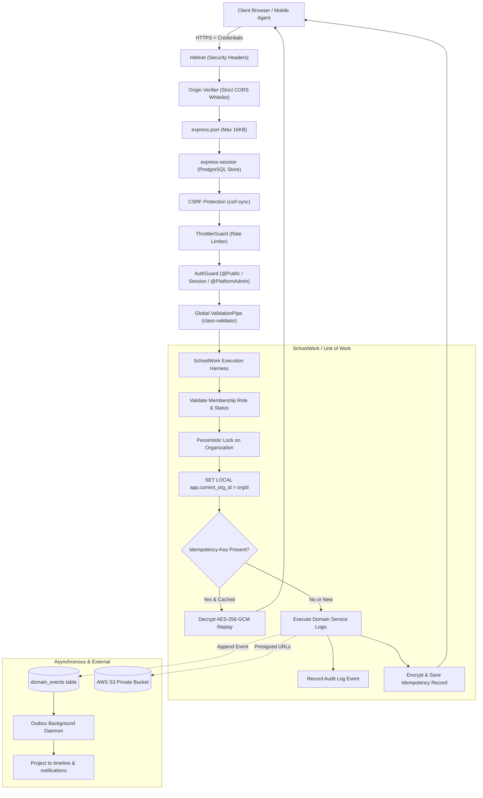
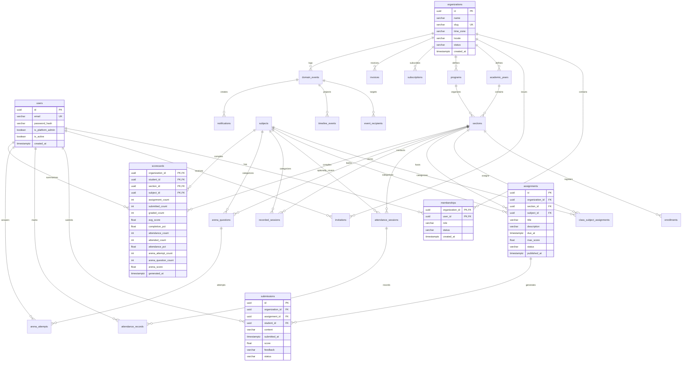
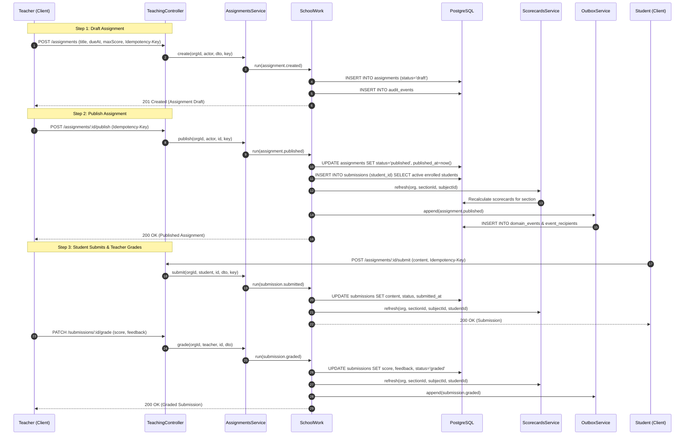
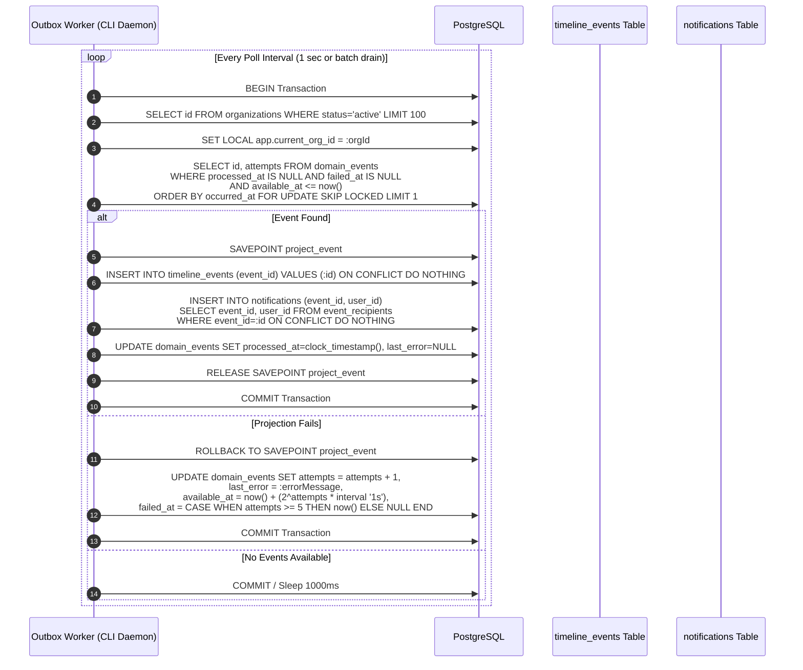
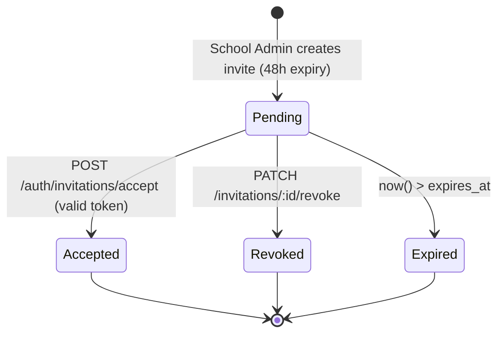
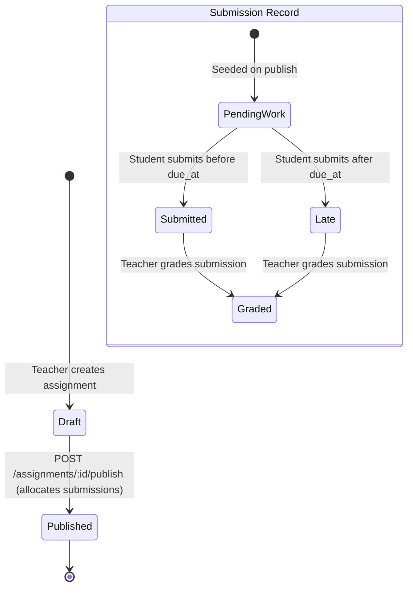
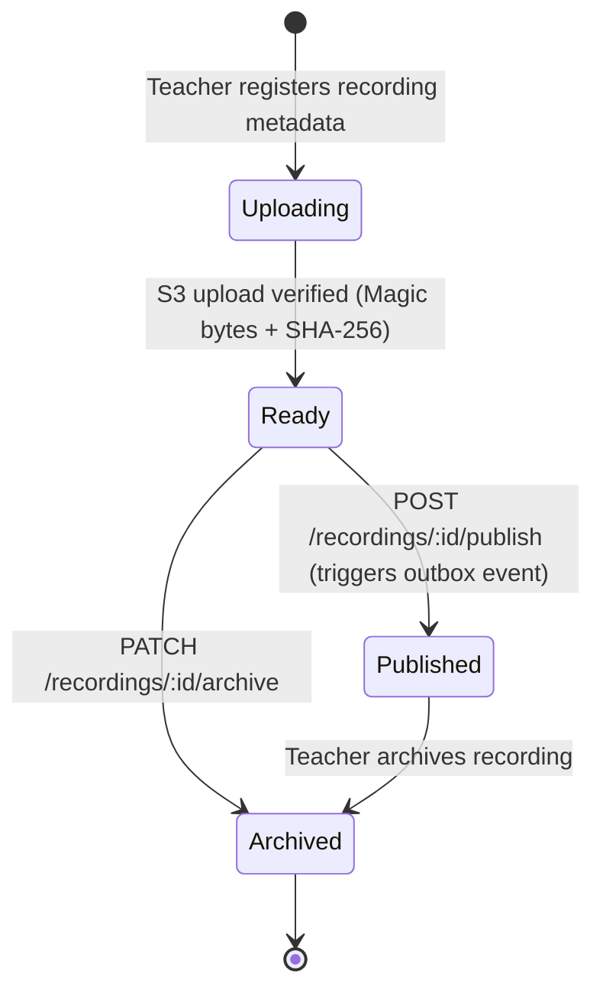

# EDOPS School SaaS — Product Requirements & Low-Level Design (LLD)

> **Document Version:** 1.0.0  
> **Target Audience:** Product Engineers, Solution Architects, System Auditors  
> **Scope:** Milestones 1–6 (Multi-Tenant Core, Academics, Teaching, Content & Outbox, Arena, Billing & Entitlements)

---

## 1. Product Overview & Vision

**EDOPS** is an enterprise-grade B2B multi-tenant Learning Management System (LMS) and school operations platform engineered for K-12 schools, colleges, and training academies. 

### 1.1 Commercial & Tenancy Model
- Sold exclusively to institutions (schools/organizations), never directly to individual teachers, parents, or students.
- Strict isolation: Each organization operates as an isolated tenant with dedicated academic calendars, student rosters, grading scorecards, and media assets.
- Dual-layer tenant isolation:
  1. Application-level tenant scoping (`organization_id` on all queries and transactional harnesses).
  2. PostgreSQL Row-Level Security (`set_config('app.current_org_id', $1, true)`) enforced across tenant tables.

---

## 2. Actors & Role Hierarchy

| Role | Scope | Key Capabilities |
|---|---|---|
| **Platform Administrator** (`platform_admin`) | Global (Cross-Tenant) | Bootstrapped via CLI. Provisions new school organizations, issues root invitations, manages global pricing plans, activates/suspends schools, views aggregate platform telemetry, and issues manual billing records. |
| **School Administrator** (`school_admin`) | Tenant-Scoped | Manages school configuration (name, timezone, locale). Provisions teachers and students individually or via bulk CSV imports. Configures academic years, programs, classes, sections, and subjects. Manages teacher assignments. |
| **Teacher** (`teacher`) | Section/Subject Assigned | Accesses only assigned sections and subjects. Creates and publishes assignments, grades student submissions with qualitative feedback, conducts and finalizes attendance sessions, publishes video recordings, and creates practice questions. |
| **Student** (`student`) | Section Enrolled | Views class timeline, personal notifications, enrolled assignments, submissions and grades, finalized attendance history, recorded lecture playbacks, and practice Arena questions. |
| **Parent** (`parent`) | Dependent Student | Read-only observation of linked student's performance, attendance history, and school notices (provisioned in core schema). |

---

## 3. Detailed Functional Requirements (M1 – M6)

### 3.1 Milestone 1: Identity, Authentication & Multi-Tenancy
- **Authentication**: Stateful sessions backed by PostgreSQL (`connect-pg-simple`), HTTP-only secure cookies (`edops_session` / `__Host-edops_session`).
- **Cryptographic Security**:
  - Native Node.js `scrypt` (`N=32768, r=8, p=3`) with 16-byte random salts.
  - Constant-time verification (`timingSafeEqual`) to neutralize timing attacks.
  - Double-submit CSRF protection (`csrf-sync`) using 32-byte session-synchronized tokens.
  - Maximum 8-hour session lifetime.
- **Tenant Management**:
  - Alphanumeric kebab-case unique slug per organization.
  - Configurable IANA timezone and locale (`en-IN`, `hi-IN`, `en-US`).
  - School suspension mechanism immediately preventing non-platform API interactions.
- **Invitation Flow**:
  - One-time invitation tokens (48-hour expiration) hashed via SHA-256 before database storage.
  - Token acceptance supports logging into existing active accounts or creating new accounts with minimum 12-character passwords.

### 3.2 Milestone 2: Academic Hierarchy & Member Roster
- **Academic Structure**:
  - `AcademicYear` with non-overlapping date bounds and current flag.
  - `Program` (Grades/Degrees) with integer sequence ordering.
  - `Section` linked to Year and Program with capacity limits (1–5000).
  - `Subject` (Code + Name) and `ClassSubjectAssignment` mapping teachers to specific section-subject pairs.
- **Student Enrollment Lifecycle**:
  - Active, Transferred, or Withdrawn student states. Unique roll numbers per section.
- **Batch Provisioning & Idempotency**:
  - Bulk JSON and streaming CSV roster import (up to 100 entries per batch, max 12 KB payload).
  - 24-hour AES-256-GCM encrypted idempotency caching keyed by `(organization_id, actor_id, Idempotency-Key)`. Replays exact outcomes on identical request hashes; rejects collisions with `409 Conflict`.

### 3.3 Milestone 3: Teaching, Attendance & Materialized Scorecards
- **Assignments Workflow**:
  - Status progression: `draft` → `published`.
  - Immutable once published. Future-dated deadlines (`dueAt > now()`).
  - Automatic student submission record initialization upon publication for all active enrollments.
- **Submissions & Grading**:
  - Plain-text submission content up to 8,000 characters.
  - Submission statuses: `pending` → `submitted` / `late` → `graded`.
  - Post-deadline resubmissions prohibited if work was already submitted.
  - Teacher grading: score (`0 <= score <= max_score`) and qualitative feedback.
- **Attendance Engine**:
  - Date constrained within active academic year and not in the future relative to school timezone.
  - Session statuses: `draft` → `finalized`.
  - Marking options: `present`, `absent`, `late`, `excused`.
  - Uniqueness constraint prevents duplicate attendance sessions for the same class/period/date.
- **Transactional Scorecards**:
  - Materialized scorecard table aggregating assignment submission counts, completion percentages, weighted average grades, attended vs counted session percentages, and practice Arena attempts.
  - Recalculated transactionally with single-student scoping on submissions, grading, and arena attempts to avoid lock contention.

### 3.4 Milestone 4: Communication Timeline, Notifications & S3 Recordings
- **Transactional Outbox Engine**:
  - Events emitted atomically in the same database transaction as domain writes (`domain_events` + `event_recipients`).
  - Decoupled worker process drains pending events via `FOR UPDATE SKIP LOCKED`.
  - Exponential backoff with jitter on projection failures; records detailed error diagnostics.
- **Feeds & Notifications**:
  - School timeline events filtered by section/subject enrollments.
  - Personal student inbox with read tracking and unread counts.
- **Private Versioned Recordings**:
  - Multi-step media upload lifecycle: `uploading` → `ready` → `published` → `archived`.
  - Presigned S3 `PUT` URLs (1-hour expiry) enforcing SHA-256 checksums, content-type headers, and `If-None-Match: *`.
  - Upload verification validates S3 object version, byte length, and file magic bytes (MP4 `ftyp` / WebM `0x1a45dfa3`) before marking `ready`.
  - Short-lived presigned `GET` playback URLs (2-minute expiry).

### 3.5 Milestone 5: Objective Arena Practice
- **Class-Scoped Question Bank**:
  - Formats: Single choice (exactly 1 correct answer) and Multiple choice (>= 1 correct answer).
  - Draft, published, and archived states. Answer keys securely excluded from public student views.
  - Categorized by topic, difficulty (`easy`, `medium`, `hard`), and string tags.
- **Deterministic Auto-Grading**:
  - Student attempts auto-graded immediately without asynchronous jobs or external LLM dependencies.
  - Immediate scorecard aggregate refresh (attempts count, question count, highest percentage score).

### 3.6 Milestone 6: Platform Billing, Entitlements & Telemetry
- **Subscription Engine**:
  - Global immutable `plans` specifying currency (`INR`), monthly billing cycle, max student/teacher seats, and feature flags (`arena`, `recordings`, `communication`).
  - Automatic 30-day default trial period for new institutions.
  - Per-tenant feature overrides allowing platform administrators to toggle specific capabilities (`inherit`, `enabled`, `disabled`).
- **Seat Enforcement**:
  - Active and pending unexpired invitations consume student and teacher seat quotas.
  - Over-quota invitations and reactivations rejected with `409 Conflict`.
- **Manual Invoicing Ledger**:
  - Platform-issued manual invoices with period bounds validation (`tstzrange` non-overlap).
  - Offline payment reconciliation with reference tracking and voiding controls.
- **Platform Telemetry**:
  - Aggregate statistics per organization: published assignments, verified storage bytes, arena attempts, open/paid invoice sums, seat capacity utilization.

---

## 4. Non-Functional Requirements (NFRs)

- **Security & Network Constraints**:
  - Strict CORS origin whitelisting (HTTPS enforced in production).
  - Production database connection requires non-superuser and non-`rolbypassrls` role.
  - Rate limiting via NestJS Throttler: 10 requests/minute on `/auth/login` and `/auth/invitations/accept`; 120 requests/minute on standard endpoints.
  - Payload limits: 16 KB for JSON bodies; 12 KB for CSV batch imports.
- **Performance & Scalability**:
  - Sub-50ms p95 on all read queries via composite indexes starting with `organization_id`.
  - Background outbox processing ensures domain write latencies remain independent of notification dispatch.
- **Auditability**:
  - Transactional audit log table (`audit_events`) capturing actor UUID, organization UUID, action verb, timestamp, and metadata for every mutative operation.

---

## 5. Low-Level Design (LLD) & Architectural Diagrams

### 5.1 System Architecture & Middleware Pipeline



---

### 5.2 Entity Relationship Diagram (Core Data Model)



---

### 5.3 Sequence Diagram: Assignment Creation, Publishing & Grading



---

### 5.4 Sequence Diagram: Asynchronous Outbox Worker Loop



---

### 5.5 State Transition Diagrams

#### A. Invitation Lifecycle


#### B. Assignment & Submission Lifecycle


#### C. Video Lecture Recording Lifecycle


---

## 6. Security & Multi-Tenant Isolation Specifications

### 6.1 PostgreSQL Row-Level Security (RLS) Matrix

Each tenant table (M2–M6) enforces RLS policies via:
```sql
ALTER TABLE <table> ENABLE ROW LEVEL SECURITY;
ALTER TABLE <table> FORCE ROW LEVEL SECURITY;

CREATE POLICY <table>_tenant_isolation ON <table>
    FOR ALL
    USING (organization_id = NULLIF(current_setting('app.current_org_id', true), '')::uuid);
```

| Table Category | Tables Enforced | RLS Scope Rule |
|---|---|---|
| **Academic Hierarchy** | `academic_years`, `programs`, `subjects`, `sections`, `class_subject_assignments`, `enrollments` | `organization_id` matched against session setting |
| **Teaching & Evaluation** | `assignments`, `submissions`, `attendance_sessions`, `attendance_records`, `scorecards` | `organization_id` matched against session setting |
| **Media & Content** | `recorded_sessions` | `organization_id` matched against session setting |
| **Practice Arena** | `arena_questions`, `arena_attempts` | `organization_id` matched against session setting |
| **Communication** | `domain_events`, `event_recipients`, `timeline_events`, `notifications` | `organization_id` matched against session setting |
| **Billing & Features** | `subscriptions`, `feature_flags`, `invoices` | `organization_id` matched against session setting |
| **Global Non-RLS Tables** | `users`, `organizations`, `memberships`, `invitations`, `plans`, `audit_events`, `sessions` | Application-level isolation via parameterized queries |

---

## 7. Verification & Operational Runbooks

### 7.1 Local Development Commands
```bash
# 1. Install dependencies
npm ci

# 2. Apply database migrations
npm run db:migrate

# 3. Bootstrap platform administrator
npm run bootstrap:admin -- admin@edops.internal

# 4. Start HTTP API server
npm run start:dev

# 5. Start background outbox daemon
npm run worker
```

### 7.2 Core Invariants
1. **No Anonymous Mutations:** Every mutative endpoint requires both a valid session cookie and a valid `X-CSRF-Token` header.
2. **Deterministic Auto-Grading:** Objective practice questions never consult external inference models; correctness is computed against strict option ID equality.
3. **Idempotent Write Safety:** Replayed requests with matching `Idempotency-Key` and payload hash return cached ciphertext without re-executing business mutations.
